# Capítulo V: Product Implementation, Validation & Deployment

## 5.1 Software Configuration Management

### 5.1.1 Software Development Environment Configuration

En esta sección se describen las herramientas de software seleccionadas para dar soporte a las distintas fases del ciclo de vida del producto digital. Se incluyen sus nombres, objetivos específicos dentro del proyecto y los enlaces de acceso o descarga, diferenciando entre soluciones SaaS y aplicaciones instalables.
* **Gestión de Proyectos y Tareas**

| Herramienta | Uso principal | Enlace / Ruta de Acceso |
|---|---|---|
| **Jira Software** | Organización de tareas y entregables mediante tableros ágiles, tanto a nivel individual como por módulo. | [https://jira.atlassian.com](https://jira.atlassian.com) |
| **GitHub Projects** | Seguimiento de proyectos con enfoque en historias de usuario, issues y Pull Requests en repositorios. | [https://github.com/features/issues](https://github.com/features/issues) |

* **Diseño de Experiencia y UI/UX**

| Herramienta | Uso principal | Enlace / Ruta de Acceso |
|---|---|---|
| **Figma** | Diseño colaborativo de wireframes, mockups y prototipos navegables para la aplicación y Landing Page. | [https://figma.com](https://figma.com) |
| **Miro** | Elaboración de user flows, wireflows, Big Picture Event Storming y mapas de arquitectura. | [https://miro.com](https://miro.com) |
| **UXPressia** | Creación de User Personas, Empathy Maps, Journey Maps e Impact Maps. | [https://uxpressia.com](https://uxpressia.com) |

* **Desarrollo de Software**

| Herramienta / Tecnología | Uso principal | Enlace / Ruta de Descarga |
|---|---|---|
| **Visual Studio Code** | Entorno de desarrollo ligero para la edición del Landing Page con HTML5, CSS3 y JavaScript. | [https://code.visualstudio.com](https://code.visualstudio.com) |
| **WebStorm** | IDE principal para el desarrollo del Frontend SPA utilizando Angular y TypeScript. | [https://www.jetbrains.com/webstorm/](https://www.jetbrains.com/webstorm/) |
| **IntelliJ IDEA** | Entorno de desarrollo integrado para la construcción del Backend API RESTful con Java y Spring Boot. | https://www.jetbrains.com/idea/ |
| **HTML5** | Lenguaje de marcado para estructurar el contenido de la Landing Page. | [https://developer.mozilla.org/es/docs/Web/HTML](https://developer.mozilla.org/es/docs/Web/HTML) |
| **CSS3** | Lenguaje de estilos para definir la apariencia visual y responsiva de la Landing Page. | [https://developer.mozilla.org/es/docs/Web/CSS](https://developer.mozilla.org/es/docs/Web/CSS) |
| **Angular** | Framework del frontend desarrollado con TypeScript y Angular Material. | [Angular](https://angular.dev/) |
| **Java (JDK 21+)** |Lenguaje de programación fuertemente tipado para la implementación de la lógica de dominio y servicios backend. | https://www.oracle.com/java/technologies/downloads/ |
| **Spring Boot** | Framework de backend en Java para la creación de microservicios y APIs RESTful desacopladas mediante Domain-Driven Design (DDD). | https://spring.io/projects/spring-boot |

* **Diseño de Arquitectura de Software**

| Herramienta | Uso principal | Enlace / Ruta de Acceso |
|---|---|---|
| **Mermaid** | Modelado de arquitectura mediante Diagramas como Código (Contexto, Contenedores C3, Clases y Base de datos). | [https://mermaid.js.org](https://mermaid.js.org) |

* **Despliegue de Software**

| Herramienta / Plataforma | Uso principal | Enlace / Ruta de Acceso |
|---|---|---|
| **Netlify** | Despliegue automático y gratuito de la Landing Page estática y el Frontend SPA. | [https://www.netlify.com](https://www.netlify.com) |
| **Railway** | Despliegue del Backend API desarrollado con Java y Spring Boot, aprovisionamiento de MySQL y administración de variables de entorno. | [Railway](https://railway.com/) |

* **Documentación de Software**

| Herramienta / Recurso | Uso principal | Enlace / Ruta de Acceso |
|---|---|---|
| **Markdown** | Edición y mantenimiento de los archivos `.md` asociados a la documentación del proyecto. | [https://www.markdownguide.org](https://www.markdownguide.org) |
| **GitHub** | Repositorio con control de versiones, utilizado además como espacio de documentación en issues y PRs. | [https://github.com](https://github.com) |
| **Git** | Sistema distribuido de control de versiones para la gestión del código fuente. | [https://git-scm.com](https://git-scm.com) |
| **GitFlow Workflow** | Modelo de ramificación para mantener el código y la documentación organizados. | [https://nvie.com/posts/a-successful-git-branching-model](https://nvie.com/posts/a-successful-git-branching-model) |
| **Conventional Commits** | Convención de mensajes de commit para mejorar la trazabilidad y facilitar la generación de changelogs. | [https://www.conventionalcommits.org](https://www.conventionalcommits.org) |
### 5.1.2 Source Code Management
El equipo empleará GitHub como repositorio de alojamiento y Git como sistema de control de versiones para todos los entregables del proyecto FleetProof. Se aplicará la estrategia de ramificación GitFlow Workflow, con el uso de Semantic Versioning y mensajes estructurados bajo la convención de Conventional Commits.

**Repositorios del Proyecto**

| Producto | Repositorio GitHub |
|---|---|
| **Organización BLIP** | [https://github.com/1ASI0729-7800-BLIP](https://github.com/1ASI0729-7800-BLIP) |
| **Landing Page** | [https://github.com/1ASI0729-7800-BLIP/blip-fleetproof-LandingPage](https://github.com/1ASI0729-7800-BLIP/blip-fleetproof-LandingPage) |
| **Project Report** | [https://github.com/1ASI0729-7800-BLIP/blip-fleetproof-project-report](https://github.com/1ASI0729-7800-BLIP/blip-fleetproof-project-report) |
| **Frontend Web App** | [https://github.com/1ASI0729-7800-BLIP/blip-fleetproof-frontend](https://github.com/1ASI0729-7800-BLIP/blip-fleetproof-frontend) |
| **Backend API** | [https://github.com/1ASI0729-7800-BLIP/blip-fleetproof-backend](https://github.com/1ASI0729-7800-BLIP/blip-fleetproof-backend) |

**Modelo GitFlow**

Se seguirá el enfoque planteado por Vincent Driessen, el cual define dos ramas principales:
* `main`: contiene las versiones estables listas para producción.
* `develop`: integra nuevas funcionalidades antes de pasar al entorno de producción.

| Tipo de rama | Uso principal | Convención de nombres | Ejemplo |
|---|---|---|---|
| **feature** | Desarrollo de funcionalidades nuevas. | `feature/<nombre-descriptivo>` | `feature/sprint1-landing` |
| **release** | Preparación de una versión previa al despliegue. | `release/vX.Y.Z` | `release/v1.0.0` |
| **hotfix** | Corrección rápida de errores en producción. | `hotfix/<problema>` | `hotfix/fix-mobile-menu` |

**Versionado Semántico**

Se implementará el esquema Semantic Versioning 2.0.0, con el formato:

**MAJOR.MINOR.PATCH**
* **MAJOR:** cambios incompatibles con versiones anteriores.
* **MINOR:** incorporación de nuevas funciones compatibles.
* **PATCH:** corrección de errores o mejoras menores.

**Conventional Commits**

Los mensajes de commit seguirán el estándar Conventional Commits para asegurar trazabilidad y generar changelogs automáticos.

Formato general: `<tipo>(<alcance-opcional>): <descripción breve>`

Tipos de commit definidos:
* `feat`: nueva funcionalidad
* `fix`: corrección de errores
* `docs`: cambios en documentación
* `style`: ajustes de formato (espacios, comas, etc.) sin afectar lógica
* `refactor`: modificaciones de código sin impacto en funciones o errores
* `test`: adición o modificación de pruebas
* `chore`: tareas de mantenimiento o generales

### 5.1.3 Source Code Style Guide & Coding Conventions

Con el objetivo de mantener un código ordenado, consistente y fácil de mantener entre todos los miembros del equipo, se han definido las siguientes convenciones. Todas las variables, funciones, clases, archivos y elementos estarán en inglés.

* Se utilizará inglés como idioma único para nombres de variables, funciones, clases, comentarios y documentación técnica.
* Se evitarán abreviaciones innecesarias y nombres genéricos como `data1`, `temp`, `info`, etc.

#### HTML

* Atributos en minúsculas y nombres de clase con `kebab-case` (`section-title`, `hero-grid`).
* Estructura semántica clara: uso de etiquetas como `<header>`, `<nav>`, `<main>`, `<section>`, `<footer>`.
* Sangría con 4 espacios.
* Atributos ordenados de manera lógica: `id`, `class`, `type`, `name`, `placeholder`, `value`, `required`, etc.

#### CSS

* Para clases personalizadas: usar `kebab-case`.
* Se agruparán variables globales en la sección `:root` (paleta de colores y espaciado).

#### Google TypeScript Style Guide

Basado en el Google TypeScript Style Guide, se adoptan las siguientes reglas para mantener un código limpio y coherente en el desarrollo de la Web Application en Angular:

Nombres y sintaxis:
* `camelCase` para variables, funciones, métodos y propiedades.
* `PascalCase` para clases, interfaces, enums, tipos y componentes.
* Constantes con `UPPER_CASE_WITH_UNDERSCORES` si son valores inmutables globales.

Módulos e imports:
* Preferir imports explícitos y ordenados: primero bibliotecas del framework (`@angular/*`), luego dependencias externas, y finalmente módulos internos del proyecto.
* Evitar `default exports`, usar siempre exportaciones nombradas (`export class`, `export interface`).

Tipado y declaraciones:
* Siempre tipar explícitamente los parámetros y valores de retorno de funciones y métodos.
* Evitar el uso de `any`; recurrir a `unknown` o tipos genéricos fuertemente tipados.
* Usar `readonly` para propiedades inmutables.
* Interfaces en lugar de `type` para modelar estructuras de datos y contratos.

Buenas prácticas:
* Preferir `const` sobre `let`, y prohibir el uso de `var`.
* No mezclar lógica de negocio dentro de componentes de vista: delegar a servicios (`@Injectable`).

#### Angular Style Guide

Siguiendo las directrices oficiales de Angular y la arquitectura por Bounded Contexts:

* **Estructura modular:** Organización estricta por Bounded Contexts, dividiendo cada contexto en capas: `domain` (modelos, entidades), `application` (servicios de orquestación, fachadas), `infrastructure` (adaptadores HTTP, repositorios) y `presentation` (componentes, vistas).
* **Nombres de archivo:** En `kebab-case` con sufijos descriptivos:
  * Componentes: `feature-name.component.ts` / `.html` / `.css`
  * Servicios: `feature-name.service.ts`
  * Modelos / Entidades: `entity-name.model.ts`
  * Interfaces / DTOs: `contract-name.interface.ts`
* **Componentes:**
  * Uso de *Standalone Components* para reducir acoplamiento y prescindir de `NgModule` redundantes.
  * Nombres de clases en `PascalCase` con sufijo `Component` (ej. `VehicleReportComponent`).
  * Selectores con prefijo estándar del proyecto en `kebab-case` (ej. `app-vehicle-report`).

#### Java & Spring Boot Coding Conventions

Para el desarrollo del Backend RESTful API alineado a Domain-Driven Design (DDD):

* **Estructura de paquetes:** Paquetes nombrados en minúsculas organizados por contexto delimitado y arquitectura hexagonal/DDD:
  * `com.blip.fleetproof.{bounded_context}.domain.model`: Agregados, entidades, objetos de valor y eventos de dominio.
  * `com.blip.fleetproof.{bounded_context}.application.internal`: Servicios de aplicación y manejo de comandos/consultas (CQRS).
  * `com.blip.fleetproof.{bounded_context}.infrastructure.persistence.jpa`: Repositorios Spring Data JPA y entidades de persistencia.
  * `com.blip.fleetproof.{bounded_context}.interfaces.rest`: Controladores REST (`@RestController`), DTOs y ensambladores (*Assemblers*).
* **Nomenclatura:**
  * Clases e interfaces en `PascalCase` (ej. `VehicleQueryService`, `SubscriptionRepository`).
  * Métodos y variables en `camelCase` descriptivo (ej. `findVehicleByPlate`, `lastCheckDate`).
  * Constantes estáticas finales en `UPPER_SNAKE_CASE`.
* **Anotaciones y principios:**
  * Inyección de dependencias mediante constructores asistidos por Lombok (`@RequiredArgsConstructor`), evitando `@Autowired` directo sobre campos.
  * Transaccionalidad declarativa explícita (`@Transactional`) en servicios de aplicación.
  * Validación de entrada con Bean Validation (`@Valid`, `@NotNull`, `@NotBlank`).

#### Pruebas / Gherkin

En caso de usar Gherkin (para especificaciones o pruebas de los escenarios descritos en las User Stories):
* Usaremos el formato estandarizado `Given`, `When` y `Then`.
### 5.1.4 Software Deployment Configuration

1. **Ingresar a Netlify** 
   Accedemos a la plataforma mediante nuestras credenciales de Github en "Log in with GitHub".
   

2. **Autorizar a Netlify**  
   Damos permisos a Netlify de acceder a nuestra cuenta de GitHub para luego ir a la sección "Sites" y presionar "Add new site". Entonces, le damos a "Import an existing project".
   

3. **Escoger tu deploy**  
   En la parte de "Let's deploy your project with..." seleccionamos GitHub.
   

4. **Escoger tu repositorio**  
   Dado que nuestro repositorio está bajo una organización, la seleccionamos.
   

5. **Configurar el despliegue**  
   Ahora procedemos a configurar el despliegue, colocando el Site Name y seleccionando el Team, también debemos escoger una rama que en este caso será la Main.
   

6. **Seguir configurando**  
   Seguimos configurando, pero esta vez seleccionando el "Publish directory" colocamos public, para finalmente darle a "Deploy demy-academy".
   

7. **Despliegue listo**  
   Ahora podemos observar que el deploy está listo y podremos ver el enlace de la web a la landing page recién desplegada.
   

Ahora con la Landing Page desplegada, cada vez que se realize un push en la rama correspondiente, se actualizara automáticamente, de esta manera evitamos repetir los pasos.  
[Link de la Landing Page](https://fleetproof-landingpage.netlify.app/)

#### Configuración del Backend en Railway

El backend utiliza un `Dockerfile` multietapa con Java 21 LTS y `railway.json` para definir `/v3/api-docs` como health check. Railway construye el JAR de Spring Boot desde GitHub, inyecta el puerto de ejecución y conecta el servicio con MySQL mediante referencias internas. Las credenciales se conservan como variables protegidas y no forman parte del repositorio.

La URL pública resultante es [https://blip-fleetproof-backend-production.up.railway.app](https://blip-fleetproof-backend-production.up.railway.app). Swagger UI está disponible en [https://blip-fleetproof-backend-production.up.railway.app/swagger-ui/index.html](https://blip-fleetproof-backend-production.up.railway.app/swagger-ui/index.html).

## 5.2 Landing Page, Services & Applications Implementation

### 5.2.1 Sprint 1

#### 5.2.1.1 Sprint Planning 1

| Sprint # | Sprint 1 |
|---|---|
| **Sprint planning background** | |
| Date | 2026/09/16 |
| Time | 5:00 PM |
| Location | Llamada grupal en la plataforma Discord |
| Prepared By | Sebastian Reyes Limo |
| Attendees (to planning meeting) | Sebastian Reyes Limo, Gonzalo Quintanilla, Jefferson Morales, Rodrigo Gómez De La Torre y Eduardo Gorbeña |
| **Sprint Goal & User Stories** | |
| Sprint 1 Goal | Nuestro enfoque está en presentar una landing page que muestre todas las funcionalidades y características de FleetProof a los visitantes. Creemos que esto generará una sólida primera impresión sobre qué es FleetProof para nuestros segmentos objetivo. Esto se confirmará cuando los usuarios accedan a la landing page y naveguen por sus secciones. |
| Sprint 1 Commitment | 21 Story Points |
| Sum of Planned Story Points | 21 |

#### 5.2.1.2 Aspect Leaders and Collaborators

Ahora presentaremos nuestro LACX (Leadership-and-Collaboration Matrix) que nos ayudará a saber quién lidera y quién colabora en cada aspecto de este primer sprint.
Los aspectos que tomamos en cuenta para este primer sprint fueron los features de nuestra Landing Page.

| Team Member Last Name, First Name | GitHub Username | Hero L/C | Nosotros L/C | Beneficios L/C | Precios L/C | Contacto L/C | Footer L/C |
|---|---|:---:|:---:|:---:|:---:|:---:|:---:|
| **Reyes Limo Sebastian** | llegastian11 | C | C | C | C | L | C |
| **Quintanilla Gonzalo** | GoldQP | L | C | C | C | C | C |
| **Morales Jefferson** | Fenfito | C | L | C | C | C | C |
| **Gómez De La Torre Rodrigo** | rod670 | C | C | C | L | C | C |
| **Gorbeña Eduardo** | EduardooGV | C | C | L | C | C | L |

**Nota.** L = *Leader* (responsable principal del aspecto).
C = *Collaborator* (apoya el desarrollo del aspecto).

#### 5.2.1.3 Sprint Backlog 1

<table>
    <tr>
        <td>Sprint #</td>
        <td colspan="7">Sprint 1</td>
    </tr>
    <tr>
        <td colspan="2">User Story</td>
        <td colspan="2">Work-Item / Task</td>
        <td>Description</td>
        <td>Estimation (Hours)</td>
        <td>Assigned To</td>
        <td>Status (Pendiente / En progreso / En revisión / Completado)</td>
    </tr>
    <tr>
        <td>Id</td>
        <td>Title</td>
        <td>Id</td>
        <td>Title</td>
        <td></td>
        <td></td>
        <td></td>
        <td></td>
    </tr>
    <tr>
        <td>US01</td>
        <td>Presentación de propuesta para flotas</td>
        <td>T1</td>
        <td>Diseñar estructura de la página principal</td>
        <td>Crear wireframe simple con encabezado, Hero section y pie de página de FleetProof.</td>
        <td>4</td>
        <td>Equipo UX</td>
        <td>Completado</td>
    </tr>
    <tr>
        <td>US01</td>
        <td>Presentación de propuesta para flotas</td>
        <td>T2</td>
        <td>Implementar página principal (Hero)</td>
        <td>Desarrollar HTML/CSS base de la página principal aplicando diseño Responsive.</td>
        <td>6</td>
        <td>Dev Front</td>
        <td>Completado</td>
    </tr>
    <tr>
        <td>US01</td>
        <td>Presentación de propuesta para flotas</td>
        <td>T3</td>
        <td>Redactar sección de Servicios</td>
        <td>Elaborar contenido con los pilares clave de la plataforma (Checklist, Semáforo, Alertas).</td>
        <td>2</td>
        <td>PO/Equipo</td>
        <td>Completado</td>
    </tr>
    <tr>
        <td>US01</td>
        <td>Presentación de propuesta para flotas</td>
        <td>T4</td>
        <td>Implementar sección de Servicios</td>
        <td>Codificar la sección en la landing page usando CSS Grid y Flexbox.</td>
        <td>4</td>
        <td>Dev Front</td>
        <td>Completado</td>
    </tr>
    <tr>
        <td>US02</td>
        <td>Beneficios para usuarios particulares</td>
        <td>T5</td>
        <td>Diseñar sección de Nosotros</td>
        <td>Definir estructura visual del equipo fundador y beneficios del Startup Profile.</td>
        <td>3</td>
        <td>Equipo UX</td>
        <td>Completado</td>
    </tr>
    <tr>
        <td>US02</td>
        <td>Beneficios para usuarios particulares</td>
        <td>T6</td>
        <td>Implementar sección de Nosotros</td>
        <td>Programar en frontend con estructura responsiva e imágenes adaptables.</td>
        <td>5</td>
        <td>Dev Front</td>
        <td>Completado</td>
    </tr>
    <tr>
        <td>US01</td>
        <td>Presentación de propuesta para flotas</td>
        <td>T7</td>
        <td>Diseñar sección de Planes</td>
        <td>Diseñar estructura de planes de suscripción con beneficios y precios diferenciados.</td>
        <td>3</td>
        <td>Equipo UX</td>
        <td>Completado</td>
    </tr>
    <tr>
        <td>US01</td>
        <td>Presentación de propuesta para flotas</td>
        <td>T8</td>
        <td>Implementar sección de Planes</td>
        <td>Codificar sección de Pricing en HTML y CSS con diseño corporativo.</td>
        <td>5</td>
        <td>Dev Front</td>
        <td>Completado</td>
    </tr>
    <tr>
        <td>US01</td>
        <td>Presentación de propuesta para flotas</td>
        <td>T9</td>
        <td>Redactar información de Contacto</td>
        <td>Crear contenido con correo corporativo, sedes y canales de WhatsApp.</td>
        <td>2</td>
        <td>PO/Equipo</td>
        <td>Completado</td>
    </tr>
    <tr>
        <td>US01</td>
        <td>Presentación de propuesta para flotas</td>
        <td>T10</td>
        <td>Implementar sección de Contacto</td>
        <td>Agregar formulario funcional simulado con validaciones básicas en JavaScript.</td>
        <td>4</td>
        <td>Dev Front</td>
        <td>Completado</td>
    </tr>
    <tr>
        <td>-</td>
        <td>-</td>
        <td>T11</td>
        <td>Configuración de hosting/despliegue</td>
        <td>Preparar entorno y publicar el Landing Page de FleetProof en Netlify.</td>
        <td>6</td>
        <td>DevOps</td>
        <td>Completado</td>
    </tr>
</table>

#### 5.2.1.4 Development Evidence for Sprint Review

Durante el Sprint 1 se implementó la Landing Page de la solución y se construyó la documentación base de arquitectura de software y experiencia de usuario. El desarrollo se realizó en los repositorios públicos de la organización BLIP, utilizando un flujo de ramas basado en feature branches y siguiendo la convención de *Conventional Commits*.

<h3>Development Evidence – Sprint 1</h3>

<table>
    <thead>
        <tr>
            <th>Repository</th>
            <th>Branch</th>
            <th>Commit Id</th>
            <th>Commit Message</th>
            <th>Commit Message Body</th>
            <th>Committed on (Date)</th>
        </tr>
    </thead>
    <tbody> 
        <tr>
            <td>1ASI0729-7800-BLIP/blip-fleetproof-project-report</td>
            <td>feature/sprint1-capitulo-1</td>
            <td>25f15d2</td>
            <td>docs: add impact maps to requirements specification</td>
            <td>Se agregan los Impact Maps al capítulo 3.</td>
            <td>17/09/2026</td>
        </tr>
        <tr>
            <td>1ASI0729-7800-BLIP/blip-fleetproof-project-report</td>
            <td>feature/sprint1-capitulo-1</td>
            <td>51945a0</td>
            <td>docs: add image for the impact mapping</td>
            <td>Inserción de imagen de Impact Mapping.</td>
            <td>17/09/2026</td>
        </tr>
        <tr>
            <td>1ASI0729-7800-BLIP/blip-fleetproof-project-report</td>
            <td>feature/sprint1-capitulo-1</td>
            <td>9827e21</td>
            <td>docs: add image for the Impact mapping</td>
            <td>Inserción de segunda imagen de Impact Mapping.</td>
            <td>17/09/2026</td>
        </tr>
        <tr>
            <td>1ASI0729-7800-BLIP/blip-fleetproof-project-report</td>
            <td>feature/sprint1-capitulo-1</td>
            <td>f4e52f6</td>
            <td>docs: Create gitkeep</td>
            <td>Creación de archivo .gitkeep para carpetas vacías.</td>
            <td>17/09/2026</td>
        </tr>
        <tr>
            <td>1ASI0729-7800-BLIP/blip-fleetproof-project-report</td>
            <td>feature/sprint1-capitulo-1</td>
            <td>7ed9426</td>
            <td>docs: implementación del punto 4.4.1</td>
            <td>Desarrollo del subcapítulo de wireframes 4.4.1.</td>
            <td>16/09/2026</td>
        </tr>
        <tr>
            <td>1ASI0729-7800-BLIP/blip-fleetproof-project-report</td>
            <td>feature/sprint1-capitulo-1</td>
            <td>54a86ca</td>
            <td>docs: Update requirements specification with new EPICs and US</td>
            <td>Actualización del capítulo 3 con nuevas épicas.</td>
            <td>16/09/2026</td>
        </tr>
        <tr>
            <td>1ASI0729-7800-BLIP/blip-fleetproof-project-report</td>
            <td>feature/sprint1-capitulo-1</td>
            <td>7011b29</td>
            <td>docs: Update user stories and product backlog details</td>
            <td>Refinamiento de las historias de usuario.</td>
            <td>16/09/2026</td>
        </tr>
        <tr>
            <td>1ASI0729-7800-BLIP/blip-fleetproof-project-report</td>
            <td>feature/sprint1-capitulo-1</td>
            <td>1470dbf</td>
            <td>docs: add Sebastian profile to chapter 1</td>
            <td>Adición del perfil de Sebastian al capítulo 1.</td>
            <td>16/09/2026</td>
        </tr>
        <tr>
            <td>1ASI0729-7800-BLIP/blip-fleetproof-LandingPage</td>
            <td>main</td>
            <td>e1d4b4a</td>
            <td>feat: migración de React a HTML, CSS y JS puro</td>
            <td>Se establece estructura SEO-friendly con Media Queries.</td>
            <td>16/09/2026</td>
        </tr>
        <tr>
            <td>1ASI0729-7800-BLIP/blip-fleetproof-LandingPage</td>
            <td>main</td>
            <td>a8b9c23</td>
            <td>feat: add hero section and responsive layout</td>
            <td>Implementación de la sección principal con tarjeta flotante.</td>
            <td>16/09/2026</td>
        </tr>
        <tr>
            <td>1ASI0729-7800-BLIP/blip-fleetproof-LandingPage</td>
            <td>main</td>
            <td>f4d5e67</td>
            <td>feat: implement pricing and services section</td>
            <td>Integración de la sección de precios y pilares en HTML.</td>
            <td>16/09/2026</td>
        </tr>
        <tr>
            <td>1ASI0729-7800-BLIP/blip-fleetproof-LandingPage</td>
            <td>main</td>
            <td>9a8b7c6</td>
            <td>style: fix mobile menu and media queries</td>
            <td>Ajustes de formato y funcionalidad de menú móvil.</td>
            <td>16/09/2026</td>
        </tr>
        <tr>
            <td>1ASI0729-7800-BLIP/blip-fleetproof-project-report</td>
            <td>feature/sprint1-capitulo-1</td>
            <td>a8979e7</td>
            <td>docs: Add new Epic/Stories and update product backlog</td>
            <td>Actualización de Épicas y Product Backlog.</td>
            <td>15/09/2026</td>
        </tr>
        <tr>
            <td>1ASI0729-7800-BLIP/blip-fleetproof-project-report</td>
            <td>feature/sprint1-capitulo-1</td>
            <td>a0aab1e</td>
            <td>docs: add image source for Jefferson Morales</td>
            <td>Imagen de perfil de Jefferson agregada.</td>
            <td>15/09/2026</td>
        </tr>
        <tr>
            <td>1ASI0729-7800-BLIP/blip-fleetproof-project-report</td>
            <td>feature/sprint1-capitulo-1</td>
            <td>6e0e68e</td>
            <td>docs(chapter-1): add image for the Student Profile</td>
            <td>Imagen agregada para el perfil de estudiante.</td>
            <td>15/09/2026</td>
        </tr>
        <tr>
            <td>1ASI0729-7800-BLIP/blip-fleetproof-project-report</td>
            <td>feature/sprint1-capitulo-1</td>
            <td>4b5c714</td>
            <td>docs: add .gitkeep to initialize assets directory</td>
            <td>Inicialización de directorio assets.</td>
            <td>15/09/2026</td>
        </tr>
        <tr>
            <td>1ASI0729-7800-BLIP/blip-fleetproof-project-report</td>
            <td>feature/sprint1-capitulo-1</td>
            <td>2ea12c5</td>
            <td>docs(assets): add .gitkeep to initialize assets directory</td>
            <td>Creación de carpeta de assets con gitkeep.</td>
            <td>15/09/2026</td>
        </tr>
        <tr>
            <td>1ASI0729-7800-BLIP/blip-fleetproof-project-report</td>
            <td>feature/sprint1-capitulo-1</td>
            <td>a51fd62</td>
            <td>docs: Add student profile for Jefferson Bayron Morales</td>
            <td>Perfil de Jefferson Morales añadido al documento.</td>
            <td>15/09/2026</td>
        </tr>
        <tr>
            <td>1ASI0729-7800-BLIP/blip-fleetproof-project-report</td>
            <td>feature/sprint1-capitulo-1</td>
            <td>6013c61</td>
            <td>docs: Implementación del capitulo 4.8</td>
            <td>Desarrollo del diagrama y diseño de Base de Datos.</td>
            <td>14/09/2026</td>
        </tr>
        <tr>
            <td>1ASI0729-7800-BLIP/blip-fleetproof-project-report</td>
            <td>feature/sprint1-capitulo-1</td>
            <td>ea11113</td>
            <td>docs: Implementación del capitulo 4.7</td>
            <td>Desarrollo de diagramas de clases Orientado a Objetos.</td>
            <td>14/09/2026</td>
        </tr>
        <tr>
            <td>1ASI0729-7800-BLIP/blip-fleetproof-project-report</td>
            <td>feature/sprint1-capitulo-1</td>
            <td>cca1296</td>
            <td>docs: Implementación del capitulo 4.6</td>
            <td>Desarrollo de Bounded Contexts y diagramas de contenedores.</td>
            <td>14/09/2026</td>
        </tr>
        <tr>
            <td>1ASI0729-7800-BLIP/blip-fleetproof-project-report</td>
            <td>feature/sprint1-capitulo-1</td>
            <td>f063dc1</td>
            <td>docs: Implementación del capitulo 4.5</td>
            <td>Redacción sobre el prototipado web.</td>
            <td>14/09/2026</td>
        </tr>
        <tr>
            <td>1ASI0729-7800-BLIP/blip-fleetproof-project-report</td>
            <td>feature/sprint1-capitulo-1</td>
            <td>6736595</td>
            <td>docs: Implementación del resto del capitulo 4.4</td>
            <td>Finalización de diagramas de flujos y UX.</td>
            <td>14/09/2026</td>
        </tr>
        <tr>
            <td>1ASI0729-7800-BLIP/blip-fleetproof-project-report</td>
            <td>feature/sprint1-capitulo-1</td>
            <td>d9e1715</td>
            <td>docs: inserción del capitulo 4.4.2</td>
            <td>Inserción de diagramas de flujo web.</td>
            <td>14/09/2026</td>
        </tr>
        <tr>
            <td>1ASI0729-7800-BLIP/blip-fleetproof-project-report</td>
            <td>feature/sprint1-capitulo-1</td>
            <td>fe6012a</td>
            <td>docs: fix image formatting in chapter IV for improved presentation</td>
            <td>Corrección de formato de imágenes en el cap 4.</td>
            <td>14/09/2026</td>
        </tr>
        <tr>
            <td>1ASI0729-7800-BLIP/blip-fleetproof-project-report</td>
            <td>feature/sprint1-capitulo-1</td>
            <td>379c8b3</td>
            <td>docs: update image source in chapter IV for improved accessibility</td>
            <td>Actualización de rutas de imágenes en artefactos de diseño.</td>
            <td>14/09/2026</td>
        </tr>
        <tr>
            <td>1ASI0729-7800-BLIP/blip-fleetproof-project-report</td>
            <td>feature/sprint1-capitulo-1</td>
            <td>87877ff</td>
            <td>docs: update chapter IV with mock-ups for FleetProof's web application on desktop and mobile</td>
            <td>Adición de mockups al capítulo 4.</td>
            <td>14/09/2026</td>
        </tr>
        <tr>
            <td>1ASI0729-7800-BLIP/blip-fleetproof-project-report</td>
            <td>feature/sprint1-capitulo-1</td>
            <td>14b0dcc</td>
            <td>docs: add additional wireframes for FleetProof's mobile interface in chapter IV</td>
            <td>Adición de wireframes en resolución móvil.</td>
            <td>14/09/2026</td>
        </tr>
        <tr>
            <td>1ASI0729-7800-BLIP/blip-fleetproof-project-report</td>
            <td>feature/sprint1-capitulo-1</td>
            <td>3b3d492</td>
            <td>docs: add wireframes for FleetProof's web application and mobile interface in chapter IV</td>
            <td>Inserción de wireframes de la app web.</td>
            <td>14/09/2026</td>
        </tr>
        <tr>
            <td>1ASI0729-7800-BLIP/blip-fleetproof-project-report</td>
            <td>feature/sprint1-capitulo-1</td>
            <td>af3331c</td>
            <td>docs: update chapter IV with detailed search and navigation systems, including wireframes for desktop and mobile</td>
            <td>Detalle de sistemas de búsqueda y navegación UX.</td>
            <td>14/09/2026</td>
        </tr>
        <tr>
            <td>1ASI0729-7800-BLIP/blip-fleetproof-project-report</td>
            <td>feature/sprint1-capitulo-1</td>
            <td>c6a3b77</td>
            <td>docs: add interview evidence to chapter 2</td>
            <td>Inclusión de capturas y enlaces a entrevistas.</td>
            <td>14/09/2026</td>
        </tr>
        <tr>
            <td>1ASI0729-7800-BLIP/blip-fleetproof-project-report</td>
            <td>feature/sprint1-capitulo-1</td>
            <td>3fda627</td>
            <td>docs: enhance chapter IV with SEO tags and meta tags for landing page and web application</td>
            <td>Definición de meta etiquetas SEO.</td>
            <td>13/09/2026</td>
        </tr>
        <tr>
            <td>1ASI0729-7800-BLIP/blip-fleetproof-project-report</td>
            <td>feature/sprint1-capitulo-1</td>
            <td>ff675f2</td>
            <td>docs: expand chapter IV with detailed labeling systems for FleetProof's web application and landing page</td>
            <td>Documentación del Labeling System.</td>
            <td>13/09/2026</td>
        </tr>
        <tr>
            <td>1ASI0729-7800-BLIP/blip-fleetproof-project-report</td>
            <td>feature/sprint1-capitulo-1</td>
            <td>f6655b4</td>
            <td>docs: update chapter IV with web style guidelines, responsive design, and information architecture</td>
            <td>Guías de estilo y arquitectura de información.</td>
            <td>13/09/2026</td>
        </tr>
        <tr>
            <td>1ASI0729-7800-BLIP/blip-fleetproof-project-report</td>
            <td>feature/sprint1-capitulo-1</td>
            <td>188bb31</td>
            <td>docs: update chapter IV with images, style guidelines, and project configuration files</td>
            <td>Subida inicial de imágenes y estilos corporativos.</td>
            <td>13/09/2026</td>
        </tr>
        <tr>
            <td>1ASI0729-7800-BLIP/blip-fleetproof-project-report</td>
            <td>feature/sprint1-capitulo-1</td>
            <td>8aeb9f3</td>
            <td>docs: update Sebastian technical profile</td>
            <td>Actualización de descripción técnica en el equipo.</td>
            <td>13/09/2026</td>
        </tr>
        <tr>
            <td>1ASI0729-7800-BLIP/blip-fleetproof-project-report</td>
            <td>feature/sprint1-capitulo-1</td>
            <td>af5bcc2</td>
            <td>docs: complete chapter 2 research artifacts</td>
            <td>Finalización de artefactos de investigación UX (User Journey, Empathy Maps).</td>
            <td>13/09/2026</td>
        </tr>
        <tr>
            <td>1ASI0729-7800-BLIP/blip-fleetproof-project-report</td>
            <td>feature/sprint1-capitulo-1</td>
            <td>2968509</td>
            <td>Update collaboration data for Sebastian Reyes Limo</td>
            <td>Matriz LACX actualizada.</td>
            <td>13/09/2026</td>
        </tr>
        <tr>
            <td>1ASI0729-7800-BLIP/blip-fleetproof-project-report</td>
            <td>feature/sprint1-capitulo-1</td>
            <td>8594853</td>
            <td>docs: Update 02-chapter-1-introduction.md</td>
            <td>Modificaciones en la introducción del documento.</td>
            <td>13/09/2026</td>
        </tr>
        <tr>
            <td>1ASI0729-7800-BLIP/blip-fleetproof-project-report</td>
            <td>feature/sprint1-capitulo-1</td>
            <td>9fef174</td>
            <td>docs: enhance chapter 1 introduction with detailed profiles of target segments and their needs</td>
            <td>Definición detallada de segmentos objetivo.</td>
            <td>12/09/2026</td>
        </tr>
        <tr>
            <td>1ASI0729-7800-BLIP/blip-fleetproof-project-report</td>
            <td>feature/sprint1-capitulo-1</td>
            <td>6e5f82a</td>
            <td>docs: add link to Lean UX Canvas in chapter 1 introduction for easy access</td>
            <td>Enlace al tablero Miro de Lean UX agregado.</td>
            <td>12/09/2026</td>
        </tr>
        <tr>
            <td>1ASI0729-7800-BLIP/blip-fleetproof-project-report</td>
            <td>feature/sprint1-capitulo-1</td>
            <td>094e49a</td>
            <td>docs: add Lean UX Canvas explanation and image for FleetProof in chapter 1</td>
            <td>Inserción visual del lienzo Lean UX.</td>
            <td>12/09/2026</td>
        </tr>
        <tr>
            <td>1ASI0729-7800-BLIP/blip-fleetproof-project-report</td>
            <td>feature/sprint1-capitulo-1</td>
            <td>7725de6</td>
            <td>docs: add Lean UX hypothesis statements for feature assumptions in chapter 1</td>
            <td>Definición de hipótesis UX para FleetProof.</td>
            <td>12/09/2026</td>
        </tr>
        <tr>
            <td>1ASI0729-7800-BLIP/blip-fleetproof-project-report</td>
            <td>feature/sprint1-capitulo-1</td>
            <td>a0b75bf</td>
            <td>docs: enhance section 1.2.2 with detailed business and user assumptions for clarity</td>
            <td>Supuestos de negocio y usuario detallados en sección 1.2.2.</td>
            <td>12/09/2026</td>
        </tr>
        <tr>
            <td>1ASI0729-7800-BLIP/blip-fleetproof-project-report</td>
            <td>feature/sprint1-capitulo-1</td>
            <td>b484374</td>
            <td>docs: refine Lean UX problem statement in chapter 1 introduction for clarity and detail</td>
            <td>Problem statement y formulación del problema definidos.</td>
            <td>12/09/2026</td>
        </tr>
        <tr>
            <td>1ASI0729-7800-BLIP/blip-fleetproof-project-report</td>
            <td>feature/sprint1-capitulo-1</td>
            <td>a4a48cb</td>
            <td>docs: add expand section 1.2.2 on Lean UX process with context on fleet management challenges</td>
            <td>Contexto inicial del proceso Lean UX y retos B2B.</td>
            <td>12/09/2026</td>
        </tr>
        <tr>
            <td>1ASI0729-7800-BLIP/blip-fleetproof-project-report</td>
            <td>feature/sprint1-capitulo-1</td>
            <td>1a2d38b</td>
            <td>docs: add expand chapter 1 introduction with detailed problem analysis and context</td>
            <td>Análisis de la problemática base en el sector automotor.</td>
            <td>12/09/2026</td>
        </tr>
        <tr>
            <td>1ASI0729-7800-BLIP/blip-fleetproof-project-report</td>
            <td>feature/sprint1-capitulo-1</td>
            <td>ea45553</td>
            <td>docs: update chapter 1 introduction with team member profiles</td>
            <td>Adición de la tabla de integrantes y descripciones.</td>
            <td>12/09/2026</td>
        </tr>
    </tbody>
</table>
#### 5.2.1.5 Execution Evidence for Sprint Review 

Durante el **Sprint 1** se implementó la Landing Page de la plataforma FleetProof, cumpliendo con los objetivos definidos en el Sprint Backlog.
La Landing Page constituye el primer punto de interacción con los usuarios, mostrando de forma clara los valores de la plataforma, los servicios ofrecidos, el perfil de la startup y los planes de suscripción disponibles.

El desarrollo se centró en:

* Diseño responsive y navegación entre secciones.
* Secciones implementadas: *Hero, Nosotros, Beneficios, Precios, Contacto, Footer*.
* Formulario de contacto con validaciones frontend implementadas.

A continuación, se presentan capturas de las principales vistas desarrolladas:

 

*Figura 5.1. Vista principal (Hero) de la Landing Page en versión de escritorio.*

 

*Figura 5.2. Vista de las secciones de Servicios y Precios de la plataforma.*

 

*Figura 5.3. Vista adaptable para dispositivos móviles con el diseño responsivo aplicado.*

#### 5.2.1.6 Services Documentation Evidence for Sprint Review

Durante el Sprint 1, el alcance principal fue la implementación de la Landing Page, por lo que no se desarrollaron servicios de backend asociados a la lógica de negocio. Sin embargo, se dejó preparado el repositorio de Web Services con estructura inicial de documentación en OpenAPI/Swagger, lo que permitirá en futuros sprints integrar endpoints de autenticación, consulta de información vehicular, generación de reportes y gestión de flotas.

#### 5.2.1.7 Software Deployment Evidence for Sprint Review

Durante el Sprint 1, se logró el despliegue exitoso de la Landing Page de FleetProof en un entorno de producción utilizando la plataforma de hosting Netlify. El entorno se encuentra configurado con integración continua (Continuous Deployment), lo que permite que cualquier cambio aprobado y fusionado en la rama `main` del repositorio de GitHub se publique de manera automática.

* **Plataforma de despliegue:** Netlify
* **Rama de despliegue:** `main`
* **URL de Producción:** [https://fleetproof-landingpage.netlify.app/](https://fleetproof-landingpage.netlify.app/)

A continuación, se presenta la evidencia del despliegue exitoso en la plataforma:

---
 

**Figura 5.4.** Evidencia de despliegue exitoso en la plataforma Netlify.

#### 5.2.1.8 Team Collaboration Insights during Sprint

Durante el Sprint 1, el equipo trabajó siguiendo la estrategia **GitFlow**, creando ramas específicas por cada *feature* o entregable de documentación (ejemplo: `feature/sprint1-capitulo-1`, `feature/sprint1-capitulo-2`, `feature/sprint1-capitulo-3`, `feature/sprint1-capitulo-4`, `feature/sprint1-capitulo-5`).

Estas ramas fueron integradas progresivamente en `develop` mediante Pull Requests y, tras la validación y resolución de conflictos correspondiente, se preparó el código consolidado para su integración en la rama principal `main`.

A continuación se presentan los **analíticos de GitHub**, que muestran la participación del equipo en commits, ramas y merges durante el Sprint. Estas evidencias confirman la colaboración activa de todos los miembros:

### 5.2.2 Sprint 2

#### 5.2.2.1 Sprint Planning 2

A continuación se presenta el sprint planning de esta segunda entrega, donde se definen el trabajo a realizar, las metas y el enfoque del equipo para el desarrollo del frontend de FleetProof.

| Sprint # | Sprint 2 |
|---|---|
| **Sprint planning background** | |
| Date | 2026/09/25 |
| Time | 6:00 PM |
| Location | Llamada grupal en la plataforma Discord |
| Prepared By | Sebastian Reyes Limo |
| Attendees (to planning meeting) | Sebastian Reyes Limo, Gonzalo Quintanilla, Jefferson Morales, Rodrigo Gómez De La Torre y Eduardo Gorbeña |
| Sprint 1 Review Summary | Durante el Sprint 1 se implementó la Landing Page de FleetProof para presentar la propuesta de valor, los servicios, los beneficios, los planes y los canales de contacto dirigidos a nuestros segmentos objetivo. El reporte registra su publicación en Netlify y la elaboración de los artefactos iniciales de requisitos y diseño. Estos entregables constituyen la base para desarrollar la Web Application en el Sprint 2. |
| Sprint 1 Retrospective Summary | Como aprendizaje para la siguiente etapa, se identificó la necesidad de mantener estricta coherencia entre los requisitos, el diseño y la implementación, delimitando responsabilidades sobre los archivos del proyecto. Para el Sprint 2 se estableció una distribución por bounded context con base común y reutilización de `shared`, reduciendo conflictos simultáneos y facilitando la integración de contribuciones mediante pull requests. |
| **Sprint Goal & User Stories** | |
| Sprint 2 Goal | Nuestro enfoque está en desarrollar la primera versión funcional del Frontend Web Application de FleetProof en Angular. Buscamos que los usuarios puedan registrar y consultar vehículos, revisar reportes estructurados con información trazable, identificar niveles de riesgo mediante semáforos visuales, importar flotas mediante archivos CSV y comparar estados históricos de snapshots. Esto se confirmará al completar los flujos principales de la aplicación integrando los bounded contexts mediante datos locales de prueba. |
| Sprint 2 Velocity | 24 Story Points aceptados |
| Sum of Planned Story Points | 24: US03 (5), US04 (3), US06 (8) y US07 (8), según el Product Backlog del capítulo III. |

#### 5.2.2.2 Aspect Leaders and Collaborators

Ahora presentaremos nuestro LACX (Leadership-and-Collaboration Matrix) que nos ayudará a saber quién lidera y quién colabora en cada aspecto de este segundo sprint.
Los aspectos que tomamos en cuenta para este sprint fueron los bounded contexts de nuestra Web Application y la base reutilizable de `shared`.

| Team Member Last Name, First Name | GitHub Username | Shared L/C | Fleet Management L/C | IAM L/C | Report Management L/C | Vehicle Monitoring L/C | Vehicle Information L/C |
|---|---|:---:|:---:|:---:|:---:|:---:|:---:|
| **Reyes Limo Sebastian** | llegastian11 | L | L | C | C | C | C |
| **Quintanilla Gonzalo** | GoldQP | C | C | L | C | C | C |
| **Morales Jefferson** | Fenfito | C | C | C | C | L | C |
| **Gómez De La Torre Rodrigo** | rod670 | C | C | C | L | C | C |
| **Gorbeña Eduardo** | EduardooGV | C | C | C | C | C | L |

**Nota.** L = *Leader* (responsable principal del aspecto).
C = *Collaborator* (apoya el desarrollo del aspecto). La matriz representa la distribución de responsabilidades acordada.

#### 5.2.2.3 Sprint Backlog 2

<table>
    <tr>
        <td>Sprint #</td>
        <td colspan="7">Sprint 2</td>
    </tr>
    <tr>
        <td colspan="2">User Story</td>
        <td colspan="2">Work-Item / Task</td>
        <td>Description</td>
        <td>Estimation (Hours)</td>
        <td>Assigned To</td>
        <td>Status (Pendiente / En progreso / En revisión / Completado)</td>
    </tr>
    <tr>
        <td>Id</td><td>Title</td><td>Id</td><td>Title</td>
        <td></td><td></td><td></td><td></td>
    </tr>
    <tr><td>-</td><td>-</td><td>T12</td><td>Configurar el Frontend Web Application</td><td>Preparar Angular, Angular Material, environments y API local con db.json.</td><td>6</td><td>Sebastian Reyes Limo</td><td>Completado</td></tr>
    <tr><td>-</td><td>-</td><td>T13</td><td>Implementar shared e internacionalización</td><td>Reutilizar contratos HTTP, formularios, layout y diccionarios español e inglés.</td><td>5</td><td>Sebastian Reyes Limo</td><td>Completado</td></tr>
    <tr><td>-</td><td>-</td><td>T14</td><td>Implementar acceso y perfil</td><td>Desarrollar inicio de sesión, registro y edición de perfil con datos de demostración.</td><td>6</td><td>Gonzalo Quintanilla</td><td>Completado</td></tr>
    <tr><td>US03</td><td>Consulta inicial por placa</td><td>T15</td><td>Implementar registro y consulta de vehículos</td><td>Desarrollar listado, formulario y detalle de vehículos para la consulta por placa.</td><td>8</td><td>Eduardo Gorbeña</td><td>Completado</td></tr>
    <tr><td>US03</td><td>Consulta inicial por placa</td><td>T16</td><td>Implementar consulta de reportes</td><td>Generar y presentar reportes con datos locales, fuentes, fechas y estados de disponibilidad.</td><td>8</td><td>Rodrigo Gómez De La Torre</td><td>Completado</td></tr>
    <tr><td>US04</td><td>Evaluación con Semáforo de Riesgo</td><td>T17</td><td>Implementar evaluación visual de riesgo</td><td>Mostrar nivel de riesgo con texto, icono y color, acompañado de las causas de la clasificación.</td><td>4</td><td>Rodrigo Gómez De La Torre</td><td>Completado</td></tr>
    <tr><td>-</td><td>-</td><td>T18</td><td>Implementar exportación PDF</td><td>Generar un archivo PDF del reporte consultado desde la aplicación.</td><td>5</td><td>Rodrigo Gómez De La Torre</td><td>Completado</td></tr>
    <tr><td>US06</td><td>Carga masiva mediante CSV</td><td>T19</td><td>Implementar importación de vehículos</td><td>Validar columnas y placas, detectar duplicados y comunicar el resultado de la importación.</td><td>7</td><td>Sebastian Reyes Limo</td><td>Completado</td></tr>
    <tr><td>US07</td><td>Comparación histórica de Snapshots</td><td>T20</td><td>Implementar comparación de reportes</td><td>Presentar diferencias entre dos estados históricos de un vehículo.</td><td>6</td><td>Rodrigo Gómez De La Torre</td><td>Completado</td></tr>
    <tr><td>US07</td><td>Comparación histórica de Snapshots</td><td>T21</td><td>Implementar monitoreo y alertas</td><td>Ejecutar ciclos manuales de demostración y registrar alertas relacionadas con cambios vehiculares.</td><td>7</td><td>Jefferson Morales</td><td>Completado</td></tr>
    <tr><td>-</td><td>-</td><td>T22</td><td>Implementar gestión de flotas y casos</td><td>Crear flotas y registrar responsables, estados y evidencia de resolución de observaciones.</td><td>6</td><td>Sebastian Reyes Limo</td><td>Completado</td></tr>
    <tr><td>-</td><td>-</td><td>T23</td><td>Aplicar identidad visual de FleetProof</td><td>Incorporar logo, paleta del capítulo IV, tipografía Inter y adaptación móvil.</td><td>4</td><td>Sebastian Reyes Limo</td><td>Completado</td></tr>
    <tr><td>-</td><td>-</td><td>T24</td><td>Integrar y validar el frontend</td><td>Revisar las ramas de los contextos y comprobar la aplicación integrada.</td><td>6</td><td>Todo el equipo</td><td>Completado</td></tr>
    <tr><td>-</td><td>-</td><td>T25</td><td>Configurar hosting y despliegue</td><td>Publicar el frontend en Netlify y configurar la Fake API en Render; validar disponibilidad y conexión pública.</td><td>4</td><td>Sebastian Reyes Limo</td><td>Completado</td></tr>
</table>

Las tareas del Sprint 2 continúan la numeración del Sprint 1, abarcando desde T12 hasta T25, totalizando 82 horas de esfuerzo técnico planificado y ejecutado por el equipo. Todas las tareas asociadas a las historias de usuario comprometidas (US03, US04, US06 y US07) y las tareas técnicas de infraestructura, internacionalización y despliegue han sido completadas y validadas con datos de prueba sobre la arquitectura de bounded contexts.

#### 5.2.2.4 Development Evidence for Sprint Review

Durante el Sprint 2 se preparó la primera versión del Frontend Web Application de FleetProof. La implementación utiliza Angular, Angular Material y TypeScript, con persistencia local mediante JSON Server y `db.json`. Se reutilizó la estructura del proyecto docente Learning Center y se organizaron los módulos mediante bounded contexts y capas de dominio, aplicación, infraestructura y presentación.

El desarrollo se encuentra en el repositorio público de la organización BLIP, utilizando ramas por contexto y la convención de *Conventional Commits*.

<h3>Development Evidence – Sprint 2</h3>

<table>
    <thead><tr><th>Repository</th><th>Branch</th><th>Commit Id</th><th>Commit Message</th><th>Commit Message Body</th><th>Committed on (Date)</th></tr></thead>
    <tbody>
        <tr><td>1ASI0729-7800-BLIP/blip-fleetproof-frontend</td><td>feature/sprint2-fleet-management</td><td><a href="https://github.com/1ASI0729-7800-BLIP/blip-fleetproof-frontend/commit/c9d1829">c9d1829</a></td><td>feat(shared): add src/app/shared/application/language.store.ts</td><td>—</td><td>05/10/2026</td></tr>
        <tr><td>1ASI0729-7800-BLIP/blip-fleetproof-frontend</td><td>feature/sprint2-fleet-management</td><td><a href="https://github.com/1ASI0729-7800-BLIP/blip-fleetproof-frontend/commit/ad9e14f">ad9e14f</a></td><td>feat(fleet): add src/app/fleet-management/application/csv-import.service.ts</td><td>—</td><td>05/10/2026</td></tr>
        <tr><td>1ASI0729-7800-BLIP/blip-fleetproof-frontend</td><td>feature/sprint2-iam</td><td><a href="https://github.com/1ASI0729-7800-BLIP/blip-fleetproof-frontend/commit/b763165">b763165</a></td><td>feat(user): add UserAssembler for transforming User entities and API resources</td><td>—</td><td>06/10/2026</td></tr>
        <tr><td>1ASI0729-7800-BLIP/blip-fleetproof-frontend</td><td>feature/sprint2-report-management</td><td><a href="https://github.com/1ASI0729-7800-BLIP/blip-fleetproof-frontend/commit/a79e65f">a79e65f</a></td><td>feat(report): implement PDF export service for vehicle reports</td><td>—</td><td>06/10/2026</td></tr>
        <tr><td>1ASI0729-7800-BLIP/blip-fleetproof-frontend</td><td>feature/sprint2-vehicle-monitoring</td><td><a href="https://github.com/1ASI0729-7800-BLIP/blip-fleetproof-frontend/commit/784d8e1">784d8e1</a></td><td>feat: Add Monitoring and Alert classes for vehicle monitoring</td><td>—</td><td>06/10/2026</td></tr>
        <tr><td>1ASI0729-7800-BLIP/blip-fleetproof-frontend</td><td>feature/sprint2-vehicle-monitoring</td><td><a href="https://github.com/1ASI0729-7800-BLIP/blip-fleetproof-frontend/commit/78e79a4">78e79a4</a></td><td>feat: Add MonitoringView component for vehicle monitoring</td><td>—</td><td>06/10/2026</td></tr>
        <tr><td>1ASI0729-7800-BLIP/blip-fleetproof-frontend</td><td>main, historial original</td><td><a href="https://github.com/1ASI0729-7800-BLIP/blip-fleetproof-frontend/commit/b33f249">b33f249</a></td><td>feat(vehicle-information): add vehicle information module, domain, infrastructure and presentation components</td><td>—</td><td>06/10/2026</td></tr>
    </tbody>
</table>

El commit original de Vehicle Information fue realizado por Eduardo en `main`. Sus archivos se conservaron posteriormente en `feature/sprint2-vehicle-information`. El traslado administrativo no se presenta como un nuevo commit de Eduardo. Los commits de los demás contextos mantienen su autoría original.

#### 5.2.2.5 Execution Evidence for Sprint Review

En este sprint se prepararon las principales vistas de FleetProof para el acceso a la plataforma, la consulta de vehículos, la visualización de reportes y el seguimiento documentario de flotas.

La versión local permite demostrar:

* Inicio de sesión y registro con datos de demostración, así como edición del perfil.
* Dashboard con indicadores de vehículos, riesgos y alertas.
* Registro, listado y detalle de vehículos.
* Reportes con fuentes, fechas de consulta, estados de disponibilidad y exportación PDF.
* Comparación histórica de snapshots.
* Monitoreo mediante ciclos manuales y revisión de alertas.
* Importación de vehículos mediante CSV y gestión de casos de resolución.
* Cambio de idioma español/inglés y adaptación a dispositivos móviles.

Las vistas utilizan el logotipo de FleetProof, la paleta cromática azul marino y verde petróleo y la tipografía Inter definidas en el capítulo IV.

La ejecución local utiliza `npm run dev`: el frontend se sirve en `http://127.0.0.1:4200` y la API simulada en `http://127.0.0.1:3000/api/v1`. Esta demostración no representa una consulta real a fuentes oficiales ni un servicio de autenticación de producción.

A continuación se presentan las capturas reales de la versión local completa utilizada para la demostración. Se verificaron el inicio de sesión con la cuenta demo, la navegación, la apertura del diálogo CSV y el cambio de idioma. No se registraron errores de ejecución JavaScript durante este recorrido; se observó una advertencia de rendimiento por la resolución del logo.

Para esta captura, el puerto 3000 estaba ocupado por otra API. El JSON Server propio se ejecutó en `127.0.0.1:3001` y el navegador de prueba redirigió las solicitudes a ese puerto, sin modificar el código. Las imágenes locales no acreditan el despliegue ni la integración remota de las ramas.

##### Acceso y perfil

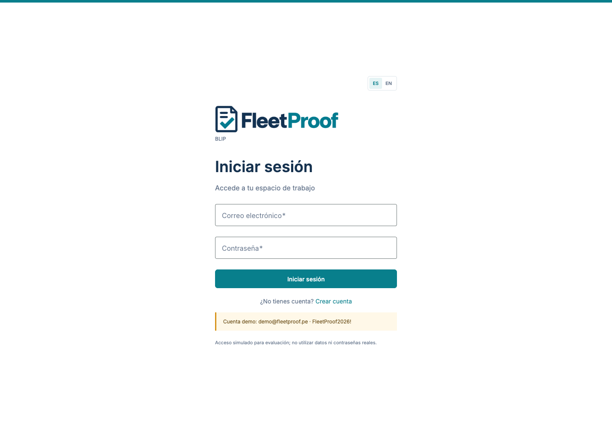

**Figura 5.5.** Formulario de inicio de sesión con identidad visual de FleetProof.

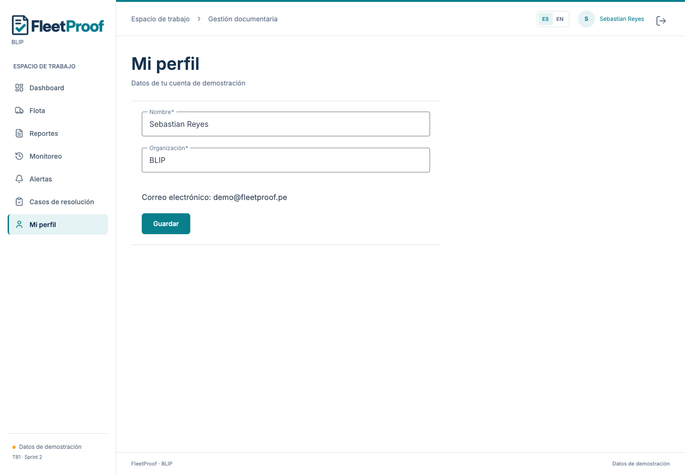

**Figura 5.6.** Vista de perfil. La captura acredita su visualización, no una actualización de datos.

##### Dashboard, internacionalización y adaptación móvil

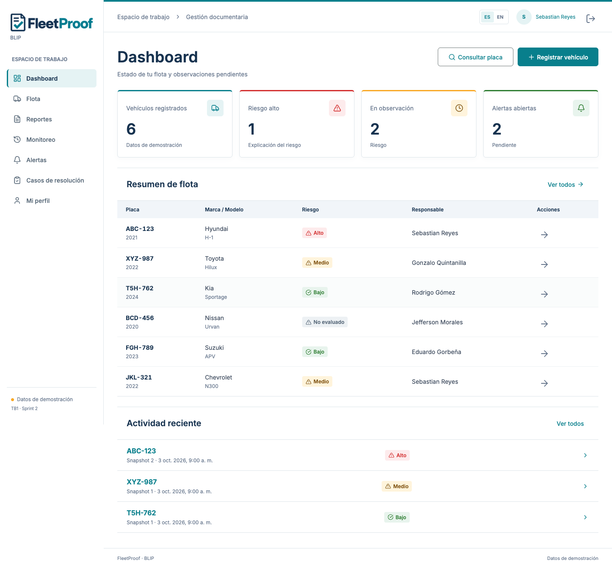

**Figura 5.7.** Indicadores y resumen de flota con datos de demostración.

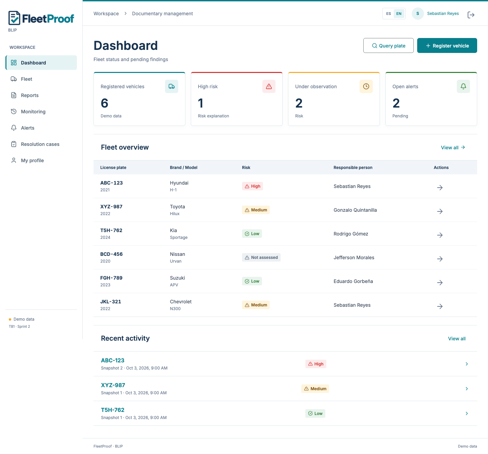

**Figura 5.8.** Resultado del cambio a inglés mediante el control EN.

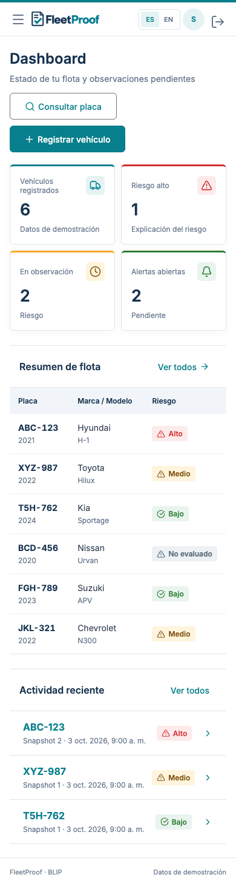

**Figura 5.9.** Adaptación del dashboard a un viewport de 390 × 844 píxeles; captura de página completa.

##### Vehículos y reportes

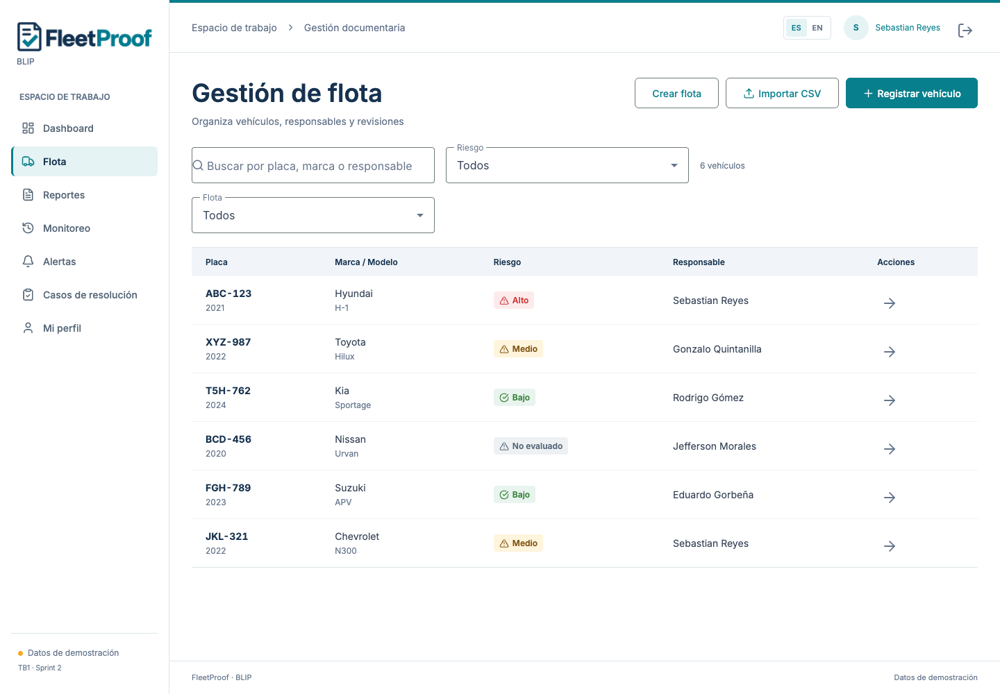

**Figura 5.10.** Listado de vehículos y sus estados de riesgo.

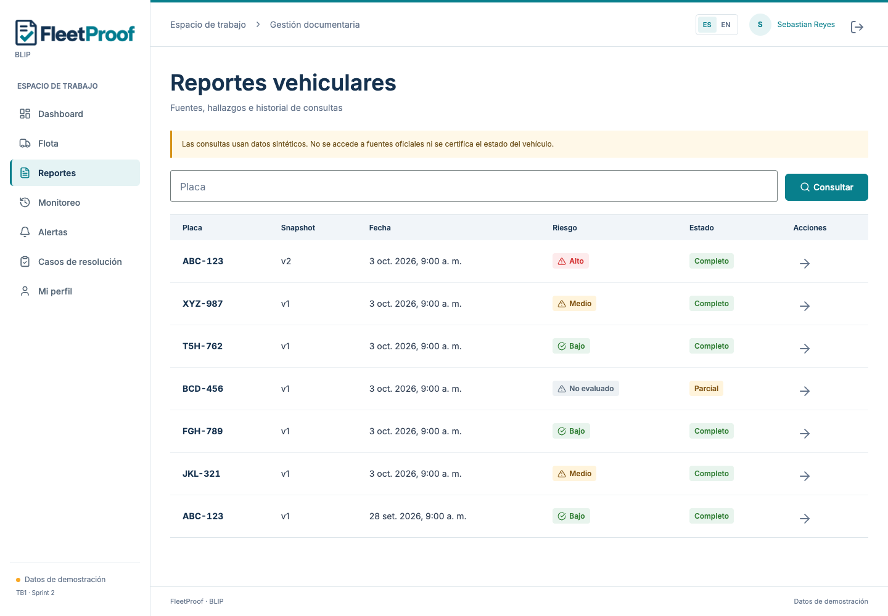

**Figura 5.11.** Reportes y versiones históricas disponibles.

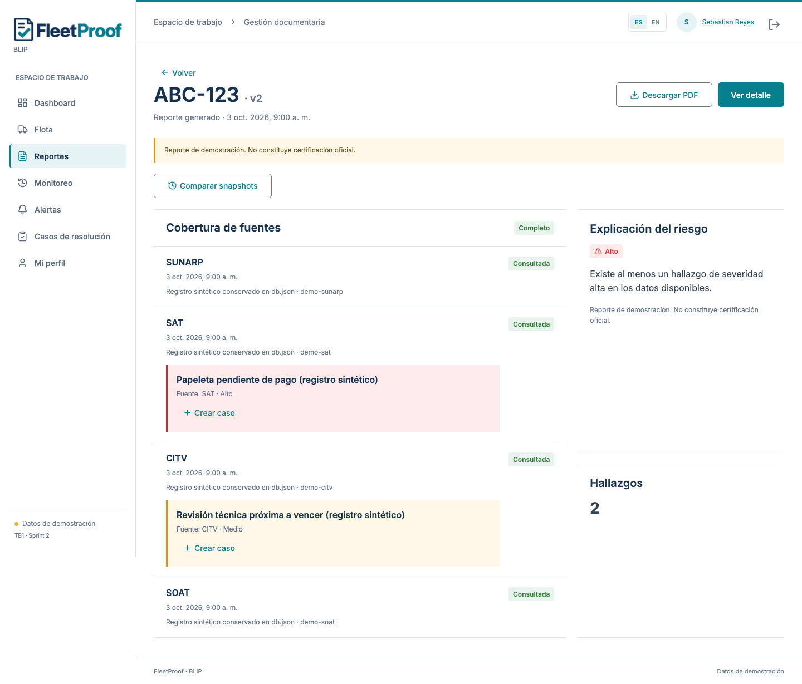

**Figura 5.12.** Detalle de un reporte existente con fuentes, fechas y riesgo. No se presenta como prueba de generación nueva o descarga PDF.

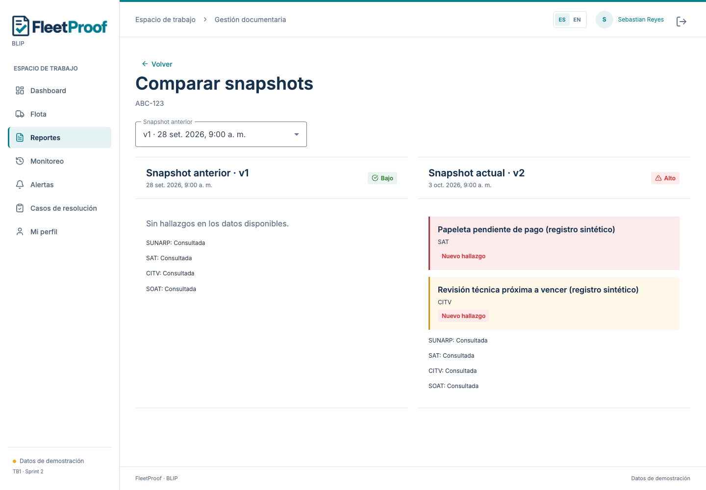

**Figura 5.13.** Vista de comparación histórica de snapshots.

##### Monitoreo, alertas y gestión de flotas

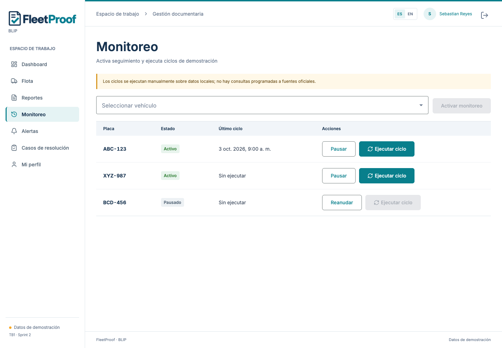

**Figura 5.14.** Vista de monitoreo. La captura no acredita la ejecución de un nuevo ciclo.

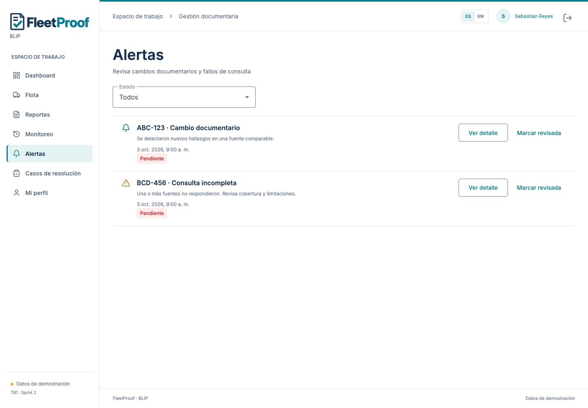

**Figura 5.15.** Visualización de alertas existentes.

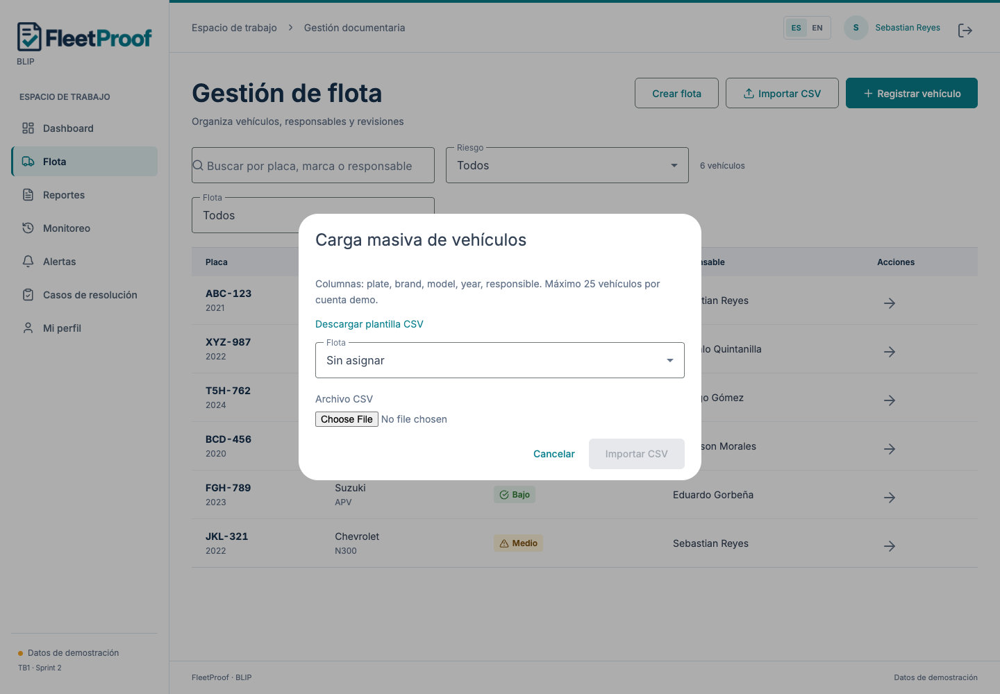

**Figura 5.16.** Diálogo de importación CSV abierto desde la interfaz. No se ejecutó una importación ni se acredita su resultado con esta imagen.

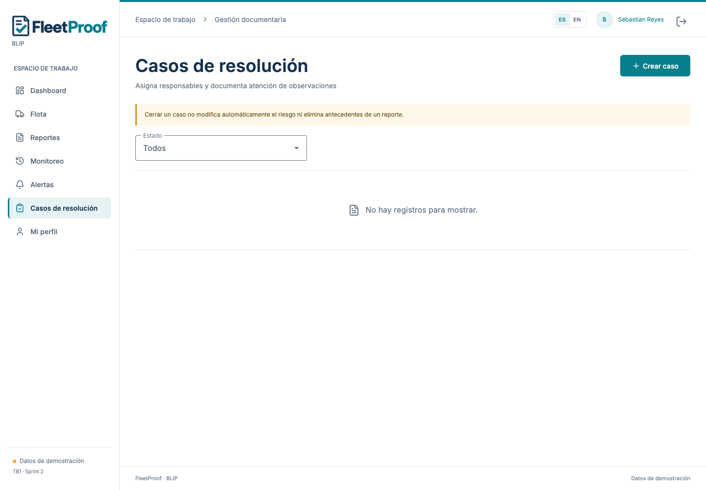

**Figura 5.17.** Vista de casos de resolución en el estado disponible de la demostración.

#### 5.2.2.6 Services Documentation Evidence for Sprint Review

Durante el Sprint 2, la Web Application consume datos de una API simulada local con JSON Server. Los recursos se almacenan en `db.json` y se accede a ellos mediante servicios HTTP organizados por bounded context. Este alcance permite demostrar el frontend antes de integrar el backend definitivo.

| Nombre del Endpoint | Acciones Implementadas | Sintaxis de Llamada | Especificación de Parámetros |
|---|---|---|---|
| Users | GET, POST, PATCH | `GET /api/v1/users`; `POST /api/v1/users`; `PATCH /api/v1/users/{id}` | Consulta de usuario para acceso simulado, registro y actualización de perfil. |
| Vehicles | GET, POST, PUT | `GET /api/v1/vehicles`; `POST /api/v1/vehicles`; `PUT /api/v1/vehicles/{id}` | Identificador, usuario, flota, placa, marca, modelo, año y responsable. |
| Reports | GET, POST | `GET /api/v1/reports`; `POST /api/v1/reports` | Vehículo, placa, fecha, versión y fuentes del reporte. |
| Source Fixtures | GET | `GET /api/v1/sourceFixtures` | Datos sintéticos utilizados para demostrar la consulta y disponibilidad de fuentes. |
| Fleets | GET, POST | `GET /api/v1/fleets`; `POST /api/v1/fleets` | Usuario y nombre de la flota. |
| Cases | GET, POST, PUT | `GET /api/v1/cases`; `POST /api/v1/cases`; `PUT /api/v1/cases/{id}` | Vehículo, reporte, observación, responsable, estado y evidencia de resolución. |
| Monitoring | GET, POST, PUT | `GET /api/v1/monitoring`; `POST /api/v1/monitoring`; `PUT /api/v1/monitoring/{id}` | Usuario, vehículo, estado y fecha del último ciclo. |
| Alerts | GET, POST, PUT | `GET /api/v1/alerts`; `POST /api/v1/alerts`; `PUT /api/v1/alerts/{id}` | Usuario, vehículo, reporte, tipo, estado, fecha y mensaje de la alerta. |

Para la internacionalización, ngx-translate carga los archivos `/i18n/es.json` y `/i18n/en.json` desde el frontend. Postman permite consultar los recursos HTTP y los diccionarios, pero no realiza la traducción de la interfaz.

La tabla anterior documenta los contratos HTTP de la versión local utilizada en la demostración. No se declara documentación Swagger del backend, porque esta entrega utiliza una API simulada. Las pruebas de integración y consumo de los endpoints mediante Postman se validaron directamente contra la instancia local de JSON Server y el servicio web desplegado en Render.

La configuración de alojamiento de la Fake API se muestra en la sección 5.2.2.7. La disponibilidad pública de cada endpoint y la correspondencia con estos contratos fueron verificadas exitosamente durante las pruebas del Sprint Review.

#### 5.2.2.7 Software Deployment Evidence for Sprint Review

Para el Sprint 2, el equipo utilizó Netlify para el despliegue del Frontend Web Application y Render para alojar la Fake API basada en JSON Server. Esta arquitectura desacoplada permite independizar la publicación de la interfaz de usuario en una red de distribución estática (CDN) del aprovisionamiento del servicio de datos simulados.

* **Plataforma de despliegue del frontend:** Netlify
* **Plataforma de despliegue de la Fake API:** Render (Web Service basado en Node.js / JSON Server)
* **Rama de despliegue del frontend:** `develop` / `main` (commit verificado `635fe67`)
* **URL de la Web Application:** [https://blip-fleetproof.netlify.app](https://blip-fleetproof.netlify.app/)
* **URL pública de la Fake API:** [https://fleetproof-fake-api.onrender.com/api/v1](https://fleetproof-fake-api.onrender.com/api/v1)
* **Repositorio de la Fake API en Render:** `1ASI0729-7800-BLIP/blip-fleetproof-fake-api`, rama `main`

A continuación se presentan las evidencias de despliegue y operatividad de la solución en la nube:

##### Configuración y despliegue de la Fake API en Render

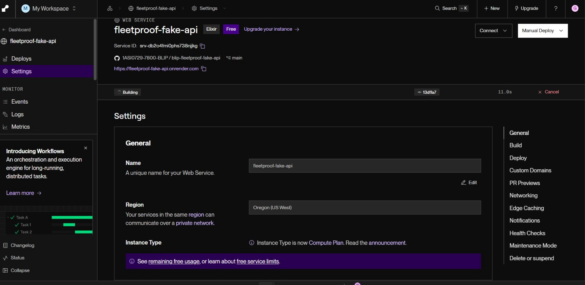

**Figura 5.18.** Despliegue del servicio `fleetproof-fake-api` en Render, aprovisionado con Node.js para ejecutar el servidor JSON Server con soporte a peticiones RESTful sobre los recursos de demostración.

##### Construcción y publicación del frontend en Netlify

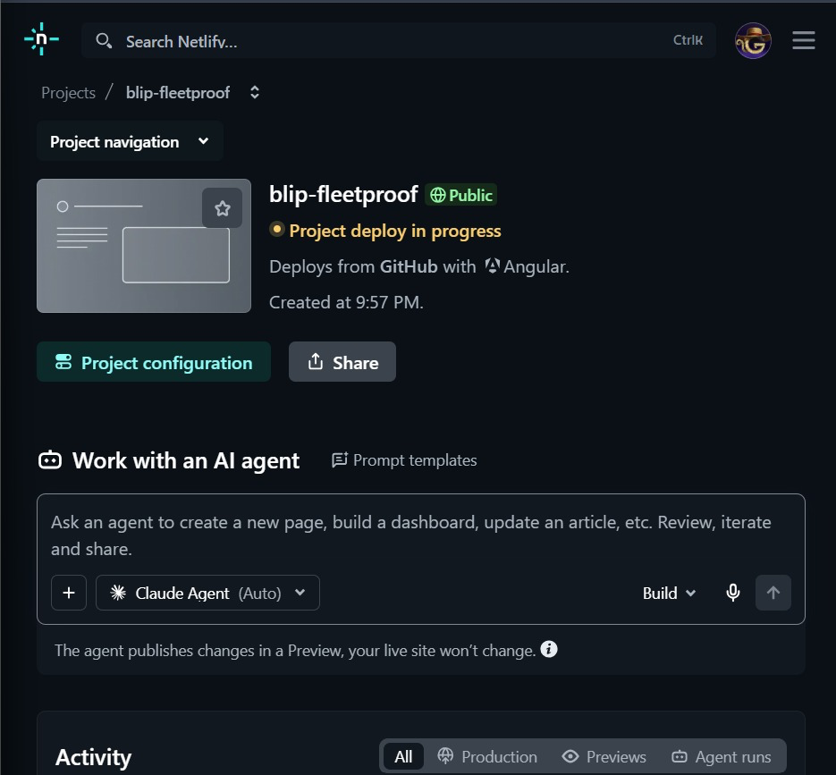

**Figura 5.19.** Pipeline de integración y construcción continua del frontend Angular en Netlify con detección de dependencias y scripts de optimización para producción.

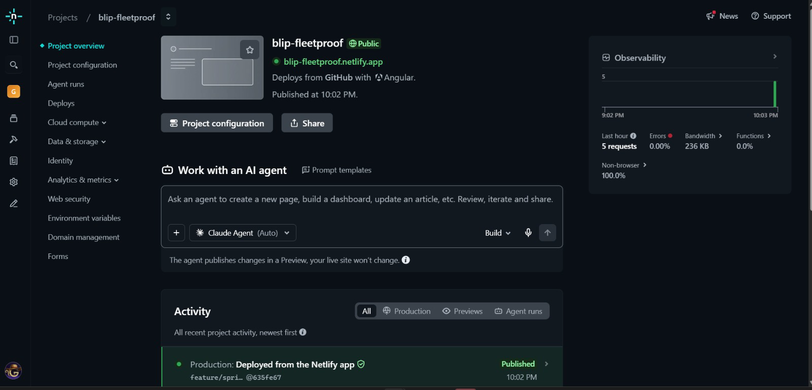

**Figura 5.20.** Publicación exitosa del Frontend Web Application en Netlify con estado `Published` y resolución DNS sobre el dominio público asignado.

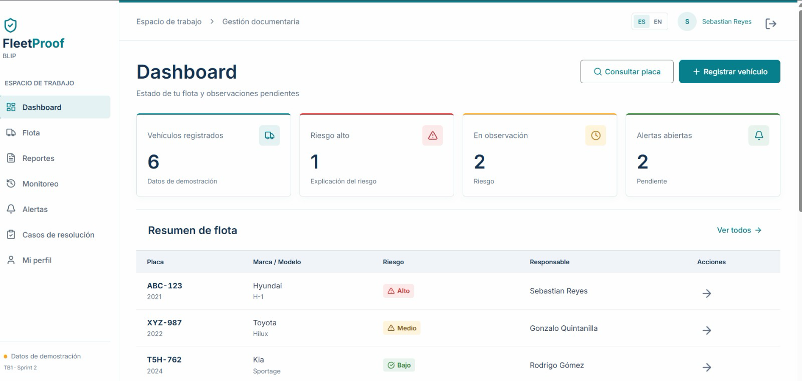

**Figura 5.21.** Interfaz de usuario de FleetProof ejecutándose en el entorno de producción desplegado, mostrando la correcta renderización de la identidad visual y los paneles de control.

#### 5.2.2.8 Team Collaboration Insights during Sprint

Durante el Sprint 2, el equipo aplicó el modelo GitFlow organizando el trabajo mediante ramas especializadas por cada Bounded Context, garantizando la independencia técnica y la no interferencia de componentes durante la fase de codificación.

| Integrante | Rama de trabajo | Aspecto |
|---|---|---|
| Sebastian Reyes Limo | `feature/sprint2-fleet-management` | Shared y Fleet Management |
| Gonzalo Quintanilla | `feature/sprint2-iam` | Identity and Access Management |
| Rodrigo Gómez De La Torre | `feature/sprint2-report-management` | Report Management |
| Jefferson Morales | `feature/sprint2-vehicle-monitoring` | Vehicle Monitoring |
| Eduardo Gorbeña | `feature/sprint2-vehicle-information` | Vehicle Information |

Para consolidar Sprint 2 se utilizaron ramas especializadas y una rama de integración. Las capturas históricas acreditan ramas, commits y Contributors; los identificadores de Pull Request no se reconstruyen en esta sección cuando no existe una referencia verificable. Los Pull Requests #9 a #14 corresponden a la integración posterior de Sprint 3 y se registran en 5.2.3.8.

A continuación se presentan los analíticos del repositorio frontend que sustentan el esfuerzo y la colaboración equitativa del equipo durante el ciclo de desarrollo:

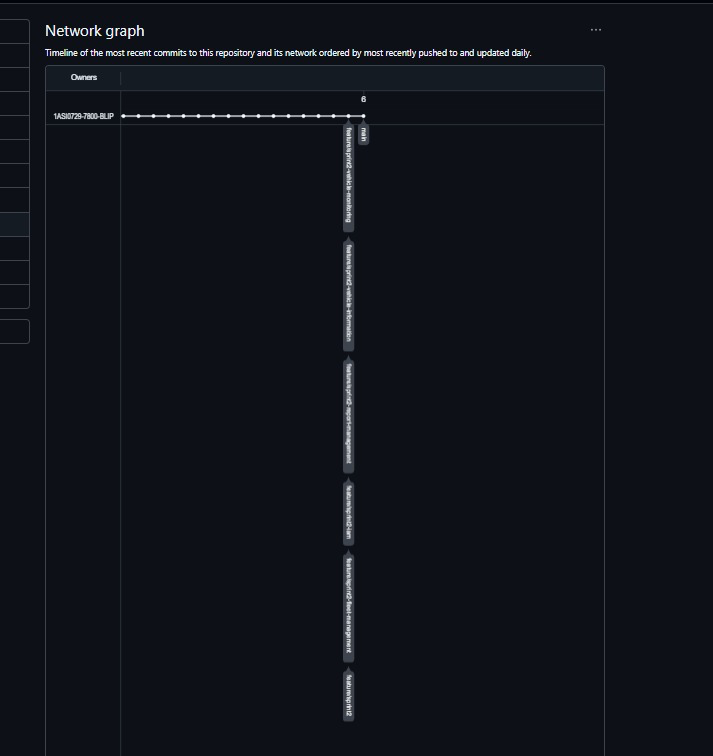

**Figura 5.22.** Network graph de GitHub que refleja la bifurcación ordenada por ramas de características correspondientes a cada Bounded Context y su posterior convergencia hacia la rama de integración del proyecto.

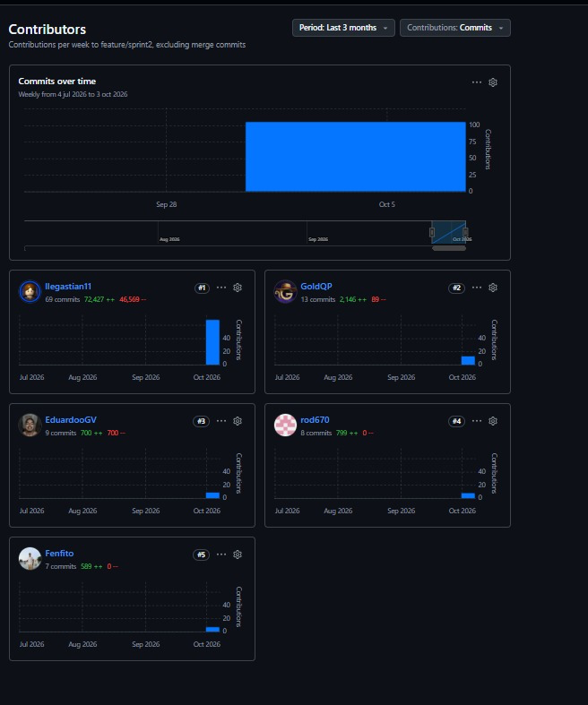

**Figura 5.23.** Resumen de contribuciones y commits registrados en el repositorio frontend. Esta evidencia acredita actividad registrada en GitHub; no sustituye la evaluación de calidad, esfuerzo, aceptación ni dominio individual del producto.

| GitHub Username | Rol en Sprint 2 | Participación y Enfoque |
|---|---|---|
| **llegastian11** | Scrum Master / Frontend Lead | Arquitectura base, módulo Shared y Fleet Management |
| **GoldQP** | Frontend Developer | Módulo Identity and Access Management (Auth / Perfil) |
| **EduardooGV** | Frontend Developer | Módulo Vehicle Information (Placas y fuentes) |
| **rod670** | Frontend Developer | Módulo Report Management (Reportes y comparación) |
| **Fenfito** | Frontend Developer | Módulo Vehicle Monitoring (Alertas y cronograma) |

[Repositorio del Frontend Web Application](https://github.com/1ASI0729-7800-BLIP/blip-fleetproof-frontend)

### 5.2.3 Sprint 3

#### 5.2.3.1 Sprint Planning 3

A continuación se presenta el sprint planning de esta tercera entrega, donde se definen el trabajo, las metas y el enfoque del equipo para desarrollar el backend de FleetProof y comenzar su conexión con el frontend.

| Sprint # | Sprint 3 |
|---|---|
| **Sprint planning background** | |
| Date | 2026/11/12 |
| Time | 6:00 PM |
| Location | Llamada grupal en la plataforma Discord |
| Prepared By | Gonzalo Quintanilla |
| Attendees (to planning meeting) | Sebastian Reyes Limo, Gonzalo Quintanilla, Jefferson Morales, Rodrigo Gómez De La Torre y Eduardo Gorbeña |
| Sprint 2 Review Summary | Durante el Sprint 2 se desarrolló la primera versión funcional del Frontend Web Application de FleetProof con Angular, organizada mediante los bounded contexts Identity and Access Management, Vehicle Information, Report Management, Vehicle Monitoring, Fleet Management y Subscription Management. Los flujos se implementaron con datos simulados y se integraron en la rama `develop`, dejando preparada la interfaz que consumirá los servicios REST del backend durante el Sprint 3. |
| Sprint 2 Retrospective Summary | Como aprendizaje para la siguiente etapa, se identificó la necesidad de sustituir progresivamente los datos simulados por contratos REST, mantener la misma estructura DDD en cada bounded context y centralizar las clases transversales en `shared`. También se acordó documentar los endpoints mediante OpenAPI y Swagger antes de iniciar la conexión con Angular. |
| **Sprint Goal & User Stories** | |
| Sprint 3 Goal | Nuestro enfoque está en desarrollar la primera versión funcional del Backend Web Service de FleetProof utilizando Java, Spring Boot y Domain-Driven Design. Buscamos implementar la base compartida y los bounded contexts Vehicle Information, Fleet Management y Report Management, exponiendo endpoints REST documentados con OpenAPI y Swagger. Esto se confirmará al ejecutar localmente las operaciones de vehículos, flotas, casos de resolución y reportes, dejando iniciada la conexión con el frontend Angular y preparado el trabajo posterior de despliegue en Railway. |
| Sprint 3 Velocity | 28 Story Points desarrollados |
| Sum of Planned Story Points | 28: US03 (5), US04 (5), US05 (5), US10 (5) y US12 (8), según el Product Backlog del capítulo III. |

#### 5.2.3.2 Aspect Leaders and Collaborators

La matriz LACX representa los aspectos técnicos del backend abordados durante el Sprint 3. La integración y el despliegue continúan como trabajo del equipo para cerrar la iteración.

| Team Member Last Name, First Name | GitHub Username | Backend Base & Shared L/C | Vehicle Information L/C | Fleet Management L/C | Report Management L/C | Frontend Integration L/C | Railway Deployment L/C |
|---|---|:---:|:---:|:---:|:---:|:---:|:---:|
| **Reyes Limo Sebastian** | llegastian11 | C | C | C | C | C | C |
| **Quintanilla Gonzalo** | GoldQP | L | L | L | L | L | L |
| **Morales Jefferson** | Fenfito | C | C | C | C | C | C |
| **Gómez De La Torre Rodrigo** | rod670 | C | C | C | C | C | C |
| **Gorbeña Eduardo** | EduardooGV | C | C | C | C | C | C |

**Nota.** L = *Leader*; C = *Collaborator*. La matriz representa responsabilidades funcionales. La autoría concreta de cada archivo o commit se verifica en GitHub y puede incluir correcciones realizadas por otro integrante durante la integración.

#### 5.2.3.3 Sprint Backlog 3

<table>
    <tr>
        <td>Sprint #</td>
        <td colspan="7">Sprint 3</td>
    </tr>
    <tr>
        <td colspan="2">User Story</td>
        <td colspan="2">Work-Item / Task</td>
        <td>Description</td>
        <td>Estimation (Hours)</td>
        <td>Assigned To</td>
        <td>Status (Pendiente / En progreso / En revisión / Completado)</td>
    </tr>
    <tr>
        <td>Id</td><td>Title</td><td>Id</td><td>Title</td>
        <td></td><td></td><td></td><td></td>
    </tr>
    <tr><td>-</td><td>Backend base</td><td>T26</td><td>Configurar proyecto Spring Boot</td><td>Preparar Gradle, aplicación principal, configuración local y dependencias de Spring Web, JPA, H2 y Springdoc.</td><td>5</td><td>Gonzalo Quintanilla</td><td>Completado</td></tr>
    <tr><td>-</td><td>Backend base</td><td>T27</td><td>Implementar capa Shared</td><td>Crear las clases base compartidas para persistencia, auditoría y estructura DDD.</td><td>5</td><td>Gonzalo Quintanilla</td><td>Completado</td></tr>
    <tr><td>-</td><td>Documentación de API</td><td>T28</td><td>Configurar OpenAPI y Swagger</td><td>Habilitar el documento OpenAPI y Swagger UI aun cuando un contexto no exponga endpoints.</td><td>3</td><td>Gonzalo Quintanilla</td><td>Completado</td></tr>
    <tr><td>US03, US05</td><td>Vehicle Information API</td><td>T29</td><td>Desarrollar Vehicle Information</td><td>Implementar agregado, capa de aplicación, persistencia JPA y controladores REST para vehículos.</td><td>8</td><td>Gonzalo Quintanilla</td><td>Completado</td></tr>
    <tr><td>US10, US12</td><td>Fleet Management API</td><td>T30</td><td>Desarrollar Fleet Management</td><td>Implementar flotas y casos de resolución mediante capas DDD y endpoints REST.</td><td>8</td><td>Gonzalo Quintanilla</td><td>Completado</td></tr>
    <tr><td>US03, US04</td><td>Report Management API</td><td>T31</td><td>Desarrollar Report Management</td><td>Implementar reportes, fuentes, hallazgos y nivel de riesgo mediante capas DDD y endpoints REST.</td><td>8</td><td>Gonzalo Quintanilla</td><td>Completado</td></tr>
    <tr><td>US03–US12</td><td>Integración técnica</td><td>T32</td><td>Consolidar los contextos del backend</td><td>Integrar la base compartida y los bounded contexts en una versión común del backend.</td><td>6</td><td>Gonzalo Quintanilla</td><td>Completado</td></tr>
    <tr><td>US03–US12</td><td>Conexión frontend–backend</td><td>T33</td><td>Conectar servicios Angular</td><td>Eliminar el consumo de JSON Server, alinear los contratos REST y configurar la URL pública del backend en Angular.</td><td>8</td><td>Equipo BLIP</td><td>Publicado en Netlify con la URL de Railway</td></tr>
    <tr><td>-</td><td>Persistencia de producción</td><td>T34</td><td>Configurar MySQL</td><td>Configurar la conexión MySQL mediante variables de entorno y referencias internas de Railway, sin almacenar credenciales en el repositorio.</td><td>5</td><td>Equipo BLIP</td><td>Completado</td></tr>
    <tr><td>-</td><td>Despliegue del backend</td><td>T35</td><td>Desplegar en Railway</td><td>Publicar Spring Boot en Railway, verificar el health check, Swagger, OpenAPI, CORS y los endpoints públicos.</td><td>6</td><td>Equipo BLIP</td><td>Completado</td></tr>
</table>

Las tareas continúan la numeración de Sprint 2, desde T26 hasta T35, y suman 62 horas planificadas. El backend consolidado, MySQL y el despliegue en Railway se encuentran completados. La compilación pública de Angular en Netlify apunta a Railway.

#### 5.2.3.4 Development Evidence for Sprint Review

El backend se consolidó en `develop` como una aplicación Spring Boot con Java 21 LTS, Gradle, Spring Web MVC, Spring Data JPA y Springdoc OpenAPI, siguiendo una organización DDD. La versión desplegada reúne User Management, Subscription Management, Vehicle Information, Vehicle Monitoring, Fleet Management y Report Management, además de `shared`. El frontend dejó de utilizar JSON Server: su configuración de producción apunta al backend de Railway y sus contratos fueron alineados con `/api/v1`.

<h3>Development Evidence – Sprint 3</h3>

<table>
    <thead><tr><th>Repository</th><th>Branch</th><th>Commit Id</th><th>Commit Message</th><th>Commit Message Body</th><th>Committed on (Date)</th></tr></thead>
    <tbody>
        <tr><td>blip-fleetproof-backend</td><td>feature/vehicle-information</td><td><a href="https://github.com/1ASI0729-7800-BLIP/blip-fleetproof-backend/commit/3b3b3a5">3b3b3a5</a></td><td>feat: add Vehicle REST controller</td><td>Cierra la primera versión del contexto Vehicle Information.</td><td>11/11/2026</td></tr>
        <tr><td>blip-fleetproof-backend</td><td>feature/fleet-management</td><td><a href="https://github.com/1ASI0729-7800-BLIP/blip-fleetproof-backend/commit/bf57c99">bf57c99</a></td><td>feat: add ResolutionCaseRepository for resolution case data access</td><td>Cierra la primera versión de Fleet Management y casos.</td><td>11/11/2026</td></tr>
        <tr><td>blip-fleetproof-backend</td><td>feature/report-management</td><td><a href="https://github.com/1ASI0729-7800-BLIP/blip-fleetproof-backend/commit/cac8527">cac8527</a></td><td>feat: add Report REST controller</td><td>Cierra la primera versión del contexto Report Management.</td><td>11/11/2026</td></tr>
    </tbody>
</table>

La tabla selecciona un commit representativo por bounded context. La configuración base, `shared` y Swagger forman parte de la estructura común del backend. El historial completo conserva los cambios por archivo; el número de commits no se utiliza como medida de esfuerzo o calidad.

#### 5.2.3.5 Execution Evidence for Sprint Review

En Sprint 3 se desplegó el backend consolidado en Railway y se verificó su disponibilidad pública. Springdoc genera 15 rutas OpenAPI y Swagger UI permite inspeccionar los contratos de los seis bounded contexts. La comprobación realizada el 13 de noviembre de 2026 obtuvo HTTP 200 para Swagger UI, `/v3/api-docs` y `/api/v1/users`; además, la respuesta CORS autorizó el origen `https://blip-fleetproof.netlify.app`.

* **Backend público:** [https://blip-fleetproof-backend-production.up.railway.app](https://blip-fleetproof-backend-production.up.railway.app).
* **Swagger UI:** [https://blip-fleetproof-backend-production.up.railway.app/swagger-ui/index.html](https://blip-fleetproof-backend-production.up.railway.app/swagger-ui/index.html).
* **OpenAPI JSON:** [https://blip-fleetproof-backend-production.up.railway.app/v3/api-docs](https://blip-fleetproof-backend-production.up.railway.app/v3/api-docs).
* **API base configurada en Angular:** `https://blip-fleetproof-backend-production.up.railway.app/api/v1`.

##### Evidencias del backend desplegado

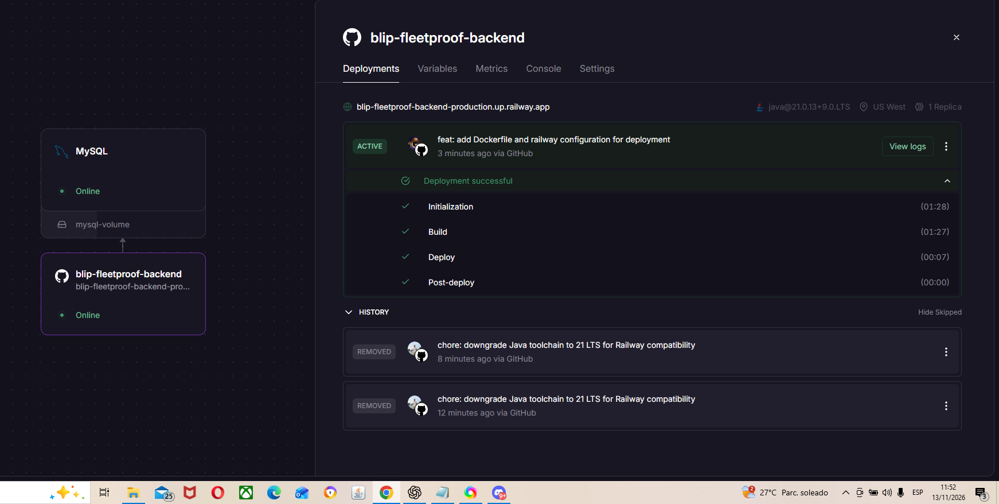

**Figura 5.24.** Servicio Spring Boot de FleetProof activo en Railway, con despliegue originado desde GitHub y sus etapas de inicialización, construcción y publicación completadas.

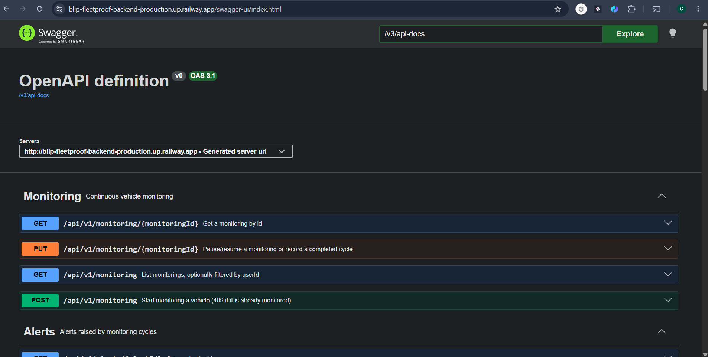

**Figura 5.25.** Swagger UI servido desde Railway, mostrando el documento OpenAPI 3.1 y los endpoints de Monitoring y Alerts.

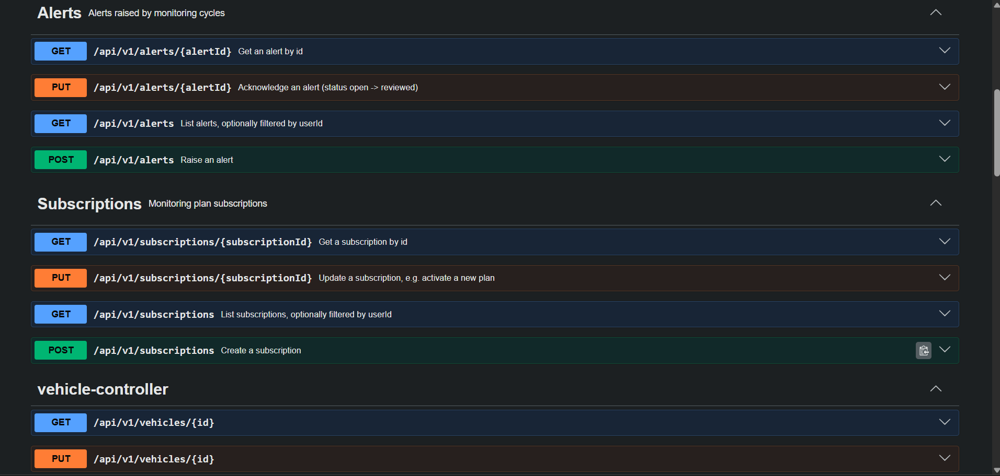

**Figura 5.26.** Contratos REST publicados para Alerts y Subscriptions, con operaciones GET, POST y PUT documentadas.

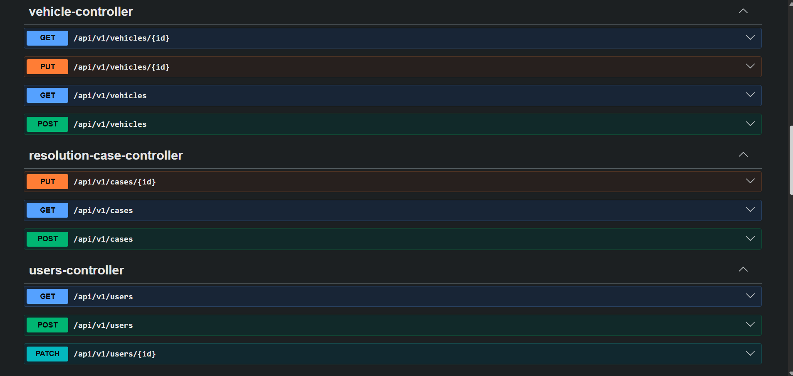

**Figura 5.27.** Contratos REST publicados para Vehicle Information, Resolution Cases y User Management mediante el prefijo común `/api/v1`.

La conexión sustituyó las URLs de JSON Server por el backend Spring Boot. El frontend superó `npm run lint` y `npm run build`, y el backend superó `gradlew test`. El [video About the Product](#54-video-about-the-product) muestra el recorrido de la aplicación.

#### 5.2.3.6 Services Documentation Evidence for Sprint Review

Los siguientes contratos corresponden al backend publicado en Railway. Angular utiliza la misma base `/api/v1`; las estructuras de recursos fueron contrastadas durante la integración y la aplicación compiló correctamente.

| Nombre del Endpoint | Acciones Implementadas | Sintaxis de Llamada | Especificación de Parámetros |
|---|---|---|---|
| Vehicles | GET, POST, PUT | `GET /api/v1/vehicles`; `GET /api/v1/vehicles/{id}`; `POST /api/v1/vehicles`; `PUT /api/v1/vehicles/{id}` | Usuario, flota, placa, marca, modelo, año, responsable, VIN y propietario. |
| Fleets | GET, POST | `GET /api/v1/fleets`; `POST /api/v1/fleets` | Usuario y nombre de la flota. |
| Resolution Cases | GET, POST, PUT | `GET /api/v1/cases`; `POST /api/v1/cases`; `PUT /api/v1/cases/{id}` | Usuario, vehículo, reporte, Finding, responsable, fecha límite, estado, evidencia y notas. |
| Reports | GET, POST | `GET /api/v1/reports`; `GET /api/v1/reports/{id}`; `POST /api/v1/reports` | Usuario, vehículo, placa, fecha, versión y snapshot de fuentes y Findings. |
| Users | GET, POST, PATCH | `GET /api/v1/users`; `POST /api/v1/users`; `PATCH /api/v1/users/{id}` | Nombre, correo, organización, tipo de cuenta y credencial transformada por el flujo actual. |
| Subscriptions | GET, POST, PUT | `GET /api/v1/subscriptions`; `GET /api/v1/subscriptions/{id}`; `POST /api/v1/subscriptions`; `PUT /api/v1/subscriptions/{id}` | Usuario, plan, límite vehicular, estado y monto. |
| Monitoring | GET, POST, PUT | `GET /api/v1/monitoring`; `GET /api/v1/monitoring/{id}`; `POST /api/v1/monitoring`; `PUT /api/v1/monitoring/{id}` | Usuario, vehículo, estado y último ciclo. |
| Alerts | GET, POST, PUT | `GET /api/v1/alerts`; `GET /api/v1/alerts/{id}`; `POST /api/v1/alerts`; `PUT /api/v1/alerts/{id}` | Usuario, vehículo, reporte, tipo, estado, fecha y clave del mensaje. |
| OpenAPI | GET | `GET /v3/api-docs` | Documento OpenAPI generado por Springdoc. |
| Swagger UI | GET | `GET /swagger-ui/index.html` | Interfaz de exploración de los endpoints disponibles en la rama ejecutada. |

Springdoc genera el documento OpenAPI en `/v3/api-docs` y Swagger UI en `/swagger-ui/index.html`. Se unificó el prefijo `/api/v1`, se habilitó CORS para Angular local y Netlify, y se eliminó del frontend el script y la dependencia de JSON Server. La consulta por placa y la integración con fuentes oficiales continúan como evolución del contrato.

#### 5.2.3.7 Software Deployment Evidence for Sprint Review

El backend se publicó en Railway mediante un `Dockerfile` multietapa con Java 21 LTS y un archivo `railway.json` que utiliza `/v3/api-docs` como health check. En el mismo proyecto se aprovisionó MySQL y se configuró su conexión mediante referencias de variables, sin versionar credenciales. El frontend conserva su despliegue en Netlify y su configuración de producción ya contiene la URL pública del backend; queda desplegar ese cambio y comprobar el recorrido desde el navegador.

* **Plataforma del frontend:** Netlify.
* **URL documentada del frontend:** [https://blip-fleetproof.netlify.app/](https://blip-fleetproof.netlify.app/).
* **Backend desplegado:** [https://blip-fleetproof-backend-production.up.railway.app](https://blip-fleetproof-backend-production.up.railway.app).
* **Swagger UI público:** [https://blip-fleetproof-backend-production.up.railway.app/swagger-ui/index.html](https://blip-fleetproof-backend-production.up.railway.app/swagger-ui/index.html).
* **OpenAPI público:** [https://blip-fleetproof-backend-production.up.railway.app/v3/api-docs](https://blip-fleetproof-backend-production.up.railway.app/v3/api-docs).
* **Base de datos local del backend:** H2 en memoria para desarrollo.
* **Plataforma del backend:** Railway.
* **Base de datos de producción:** MySQL en Railway, configurada mediante variables de entorno.
* **Estado del backend:** activo y accesible públicamente.
* **Estado de la conexión Angular:** publicada en Netlify con la URL de Railway. El 13 de noviembre de 2026, una consulta de lectura a `GET /api/v1/vehicles` desde el origen público de Netlify devolvió HTTP 200 y JSON.

##### Evidencias de configuración y despliegue en Railway

Las capturas siguientes registran la creación del servicio, la integración con GitHub, la configuración protegida y el resultado del despliegue. Los valores de contraseñas y cadenas de conexión permanecen ocultos.

**Evidencia 1: Creación del proyecto y servicio en Railway**

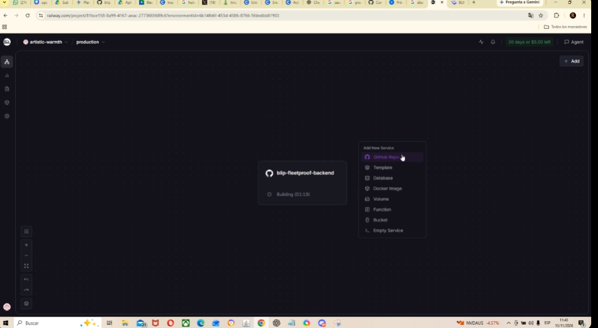

**Figura 5.28.** Proyecto de FleetProof y servicio destinado al backend Spring Boot creados en Railway.

**Evidencia 2: Conexión del repositorio del backend**

**Figura 5.29.** Repositorio y rama del backend seleccionados como fuente del despliegue automático en Railway.

**Evidencia 3: Configuración de variables de entorno**

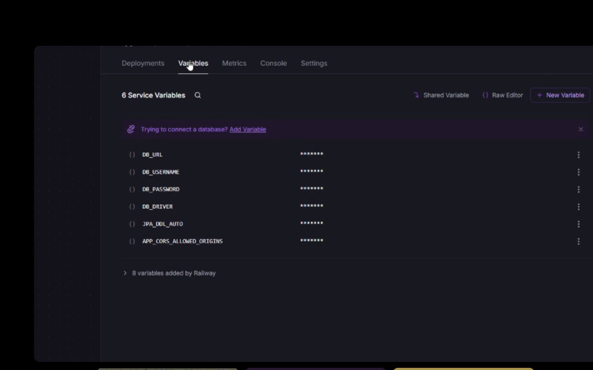

**Figura 5.30.** Variables de entorno requeridas por Spring Boot y la conexión MySQL configuradas en Railway, con los valores sensibles ocultos.

**Evidencia 4: Configuración y resultado del despliegue**

**Figura 5.31.** Configuración de construcción y ejecución del servicio, junto con el despliegue exitoso del backend en Railway.

La evidencia confirma la publicación del backend y la disponibilidad de Swagger. La prueba de lectura confirma la comunicación desde Netlify.

#### 5.2.3.8 Team Collaboration Insights during Sprint

El trabajo del backend se dividió por bounded context para evitar mezclar cambios durante la construcción inicial. Las ramas `feature/vehicle-information`, `feature/fleet-management` y `feature/report-management` comparten la misma base Spring Boot, la capa `shared` y la configuración de Swagger. Esta organización permitió desarrollar y revisar cada módulo de forma independiente antes de consolidarlo.

| Participación registrada | Alcance técnico | Estado |
|---|---|---|
| Gonzalo Quintanilla (`GoldQP`) | Base Spring Boot, `shared`, Swagger, integración de contextos, configuración Railway y alineación del frontend. | Backend consolidado y desplegado; conexión incorporada al código Angular. |
| Equipo BLIP | Revisión de contratos, conexión de los servicios Angular y comprobación del entorno público. | Backend y comunicación de lectura desde Netlify verificados. |

La principal lección del sprint es que cada bounded context debe conservar la misma estructura DDD y compartir únicamente elementos transversales mediante `shared`. La integración exigió unificar DTOs, prefijos `/api/v1`, CORS y manejo de errores antes de retirar JSON Server. Railway permitió publicar el backend y MySQL sin versionar credenciales.

## 5.3 Validation Interviews

### 5.3.1 Diseño de Entrevistas

Las entrevistas de validación se diseñaron para contrastar la comprensión y utilidad percibida del frontend de FleetProof en los dos segmentos definidos por el equipo: personas que evalúan o monitorean un vehículo y empresas que administran una flota. Las sesiones se realizaron sobre una versión local con datos de demostración; por ello, sus resultados no acreditan integración con fuentes oficiales, pagos reales ni envío efectivo de alertas.

| Elemento | Diseño aplicado |
|---|---|
| Objetivo | Identificar si las personas comprenden la consulta por placa, el nivel de riesgo, el monitoreo, la gestión de flotas y la activación de una suscripción. |
| Participantes | Un participante del segmento particular y una participante del segmento empresarial. |
| Modalidad | Sesión remota moderada con pantalla compartida y grabación. |
| Prototipo evaluado | Frontend local de FleetProof con datos simulados. |
| Recorrido | Inicio de sesión; consulta y revisión de un reporte; explicación de fuentes y riesgos; monitoreo; flotas; y activación simulada de un plan. |
| Preguntas de cierre | Utilidad percibida, información faltante, confianza en el resultado, intención de uso y recomendación. |
| Evidencia | Grabación de cada sesión y registro de observaciones con marcas de tiempo. |

El moderador controló el navegador mientras los participantes observaban el recorrido y respondían preguntas. En consecuencia, estas sesiones permiten recoger comprensión, expectativas e intención de uso, pero no miden la capacidad de completar tareas de manera autónoma ni el tiempo de ejecución de cada participante.

### 5.3.2 Registro de Entrevistas

El 11 de noviembre de 2026 se realizaron dos sesiones moderadas. Sebastian Reyes Limo compartió su pantalla y operó la aplicación en un entorno local. Los tiempos consignados son aproximados y se cuentan desde el inicio de cada grabación enlazada.

| Participante | Segmento representado | Duración | Evidencia |
|---|---|---:|---|
| Cristhian Amaya | Particular. Escenario de compra de un vehículo usado y seguimiento posterior. | 3 min 50 s | [Ver grabación de Cristhian](https://drive.google.com/file/d/1CtNP9LyLidYjLD7K_gaAsz1zfq1H0Lq8/view?usp=sharing) |
| Roxana Limo | Empresa. Jefa de marca con vehículos de prueba de manejo en tres ciudades. | 4 min 09 s | [Ver grabación de Roxana](https://drive.google.com/file/d/1rnyaSSVS_42uR4PmsGFv6SOQrKGxjh5N/view?usp=sharing) |

#### Entrevista 1. Cristhian Amaya

El moderador inició sesión y mostró la consulta por placa, el reporte `ABC-123` en su versión 3, las fuentes y hallazgos, y los planes de monitoreo individual.

| Minuto | Observación | Implicación para el producto |
|---|---|---|
| 00:16–00:35 | Ante el escenario de compra, Cristhian indicó que buscaría por placa en distintas fuentes y tendría que consultarlas una por una. | Reunir los resultados en un reporte responde a la dispersión de información que describió. |
| 01:19–01:47 | Preguntó qué datos podrían obtenerse de SUNARP. Mostró interés en el historial de propietarios, precios anteriores y garantías asociadas al vehículo. | Explicar qué campos están disponibles por fuente y cuáles quedan fuera de la cobertura. El interés expresado no acredita que la versión actual ofrezca esos datos. |
| 02:33–03:16 | Preguntó si la información se consulta al momento o se obtiene de una base previa. También planteó qué ocurriría si apareciera una papeleta una semana después. | Mostrar la fecha de la información y diferenciar la consulta puntual del seguimiento; precisar la frecuencia y el canal de notificación. |
| 03:24–03:41 | Dijo que usaría el producto para evaluar una compra y para monitorear su vehículo. | Priorizar alertas comprensibles y oportunas para cambios posteriores a la consulta. El comentario expresa intención de uso. |

#### Entrevista 2. Roxana Limo

El moderador mostró el inicio con reportes recientes, el detalle del reporte `ABC-123`, la vista de Flota y la activación simulada de una suscripción mediante QR. Se mostró un plan individual, aunque el escenario correspondía al segmento empresarial.

| Minuto | Observación | Implicación para el producto |
|---|---|---|
| 00:50–01:17 | Roxana identificó la columna **Riesgo** como lo primero que llamó su atención. | Mantener visible el nivel de riesgo y facilitar el acceso al hallazgo que lo explica. |
| 02:00–02:55 | Valoró la información centralizada. Indicó que coordina alrededor de 25 vehículos de prueba de manejo en tres ciudades y consulta a distintas áreas para conocer kilometraje, movimiento y papeletas. | Explorar la agrupación por sede y el seguimiento de responsables. La sesión no acredita que FleetProof registre kilometraje o movimiento. |
| 03:06–03:12 | El moderador abrió el QR del plan semanal individual por S/ 9 y confirmó la activación. La pantalla mostró **Semanal** y **Activa**. | Se observó el cambio de estado del flujo simulado. Falta probar una cuenta empresarial y un plan adecuado para aproximadamente 25 vehículos. |
| 03:12–03:52 | El moderador creó una flota y apareció la nueva agrupación con cero vehículos asignados. Roxana calificó la plataforma como amigable y señaló que la recomendaría. | La creación de la agrupación fue visible. Falta observar si una persona puede asignar vehículos y responsables sin ayuda. |

#### Síntesis de resultados

Ambas sesiones apuntan al valor percibido de centralizar la información vehicular. Cristhian distinguió la decisión de compra del seguimiento posterior; Roxana destacó la visibilidad del riesgo y la gestión centralizada. Las grabaciones muestran el frontend local con registros de demostración y una activación simulada. No demuestran conexión con fuentes externas, alertas por correo, pagos reales ni reducción de tiempo operativo.

| Prioridad | Mejora derivada | Próxima comprobación |
|---|---|---|
| Alta | Diferenciar **Reporte por placa** de **Monitoreo** y mostrar fecha de datos, frecuencia y canal de alertas. | Pedir que la persona explique qué ocurriría si aparece una papeleta después del reporte. |
| Alta | Explicar la cobertura y alcance de cada fuente. | Pedir que identifique qué información puede usar y cuál debe verificar por otro medio. |
| Alta | Revisar capacidad de planes empresariales y probar la gestión de flotas con una cuenta empresarial. | Utilizar un escenario de 25 vehículos en varias sedes. |
| Media | Evaluar sede, kilometraje y movimiento como requisitos empresariales. | Confirmar responsables, origen de los datos y frecuencia de actualización. |

### 5.3.3 Evaluaciones según heurísticas

Se realizó una revisión documental preliminar de la interfaz mostrada durante las sesiones, tomando como referencia las heurísticas de usabilidad de Nielsen. Esta evaluación no reemplaza una inspección completa realizada por varios especialistas ni una prueba autónoma con usuarios; su propósito es convertir los hallazgos observados en acciones verificables.

| Heurística | Evidencia o riesgo observado | Recomendación | Severidad preliminar |
|---|---|---|---:|
| Visibilidad del estado del sistema | El riesgo y el estado de la suscripción son visibles, pero no siempre se explicitan fecha de consulta, frecuencia de monitoreo o vigencia de la información. | Mostrar última actualización, próxima revisión y canal de alerta. | 3 |
| Correspondencia con el mundo real | Términos como *Finding*, fuente y monitoreo pueden interpretarse de manera distinta por una persona no técnica. | Usar vocabulario en español y explicaciones breves asociadas a cada fuente y hallazgo. | 2 |
| Control y libertad del usuario | La demostración no permitió comprobar cancelación, retroceso o edición en todos los flujos. | Incorporar acciones claras para volver, cancelar, editar y confirmar operaciones. | 2 |
| Consistencia y estándares | Los estados de reportes, riesgos, casos y suscripciones requieren una terminología uniforme. | Definir un catálogo único de estados, colores y etiquetas para todos los contextos. | 2 |
| Prevención de errores | La activación y la creación de flotas usan datos simulados; no se observó prevención completa de selecciones incompatibles. | Validar límites del plan, campos obligatorios y confirmaciones antes de guardar. | 3 |
| Reconocimiento antes que recuerdo | La columna de riesgo ayuda a priorizar, pero la cobertura de fuentes y los pasos siguientes no siempre permanecen visibles. | Mostrar resumen de fuentes, explicación del riesgo y acción recomendada en el mismo contexto. | 2 |
| Flexibilidad y eficiencia de uso | El recorrido individual no cubre las necesidades de una operación empresarial de aproximadamente 25 vehículos. | Añadir agrupación por sede, filtros, asignación masiva y vistas según rol, luego validarlas. | 3 |
| Diseño estético y minimalista | Las pantallas centralizan información útil, aunque el detalle puede crecer conforme se incorporen nuevas fuentes. | Aplicar jerarquía visual y divulgación progresiva para evitar sobrecarga. | 1 |
| Ayuda para reconocer y recuperarse de errores | No se comprobó el comportamiento ante una fuente no disponible, una consulta fallida o un pago rechazado. | Presentar mensajes específicos, conservar los datos ingresados y ofrecer reintento. | 3 |
| Ayuda y documentación | Las sesiones revelaron dudas sobre cobertura, actualidad de datos y funcionamiento de alertas. | Incorporar ayuda contextual y una página de cobertura, frecuencia y limitaciones. | 2 |

La escala preliminar utilizada es: 0 = no representa un problema; 1 = cosmético; 2 = menor; 3 = importante; 4 = crítico. Antes de declarar cerrados estos hallazgos, el equipo debe asignar evaluadores, repetir el recorrido de forma independiente y adjuntar capturas o registros que permitan comprobar cada corrección.

## 5.4 Video About-the-Product

El video muestra el recorrido de FleetProof para consultar una placa, interpretar el riesgo de un reporte y revisar el monitoreo y la gestión de flotas.

| Elemento | Evidencia |
|---|---|
| Video | [Ver en Google Drive](https://drive.google.com/file/d/1k0bitM5iUU-4UJTjsc9pVj1xav-0AAPJ/view?usp=sharing) |
| Duración | 2 min 23 s |
| Incorporación a la entrega AV2 | 12 de noviembre de 2026 |
| Reproductor | [Sobre BLIP en la landing](https://fleetproof-landingpage.netlify.app/#about-blip) |

[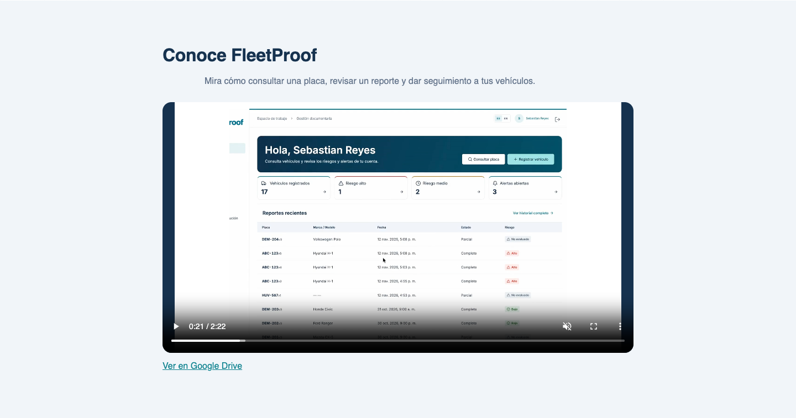](https://drive.google.com/file/d/1k0bitM5iUU-4UJTjsc9pVj1xav-0AAPJ/view?usp=sharing)

**Figura 5.32.** Reproductor del video recortado en la landing de FleetProof publicada en Netlify.
